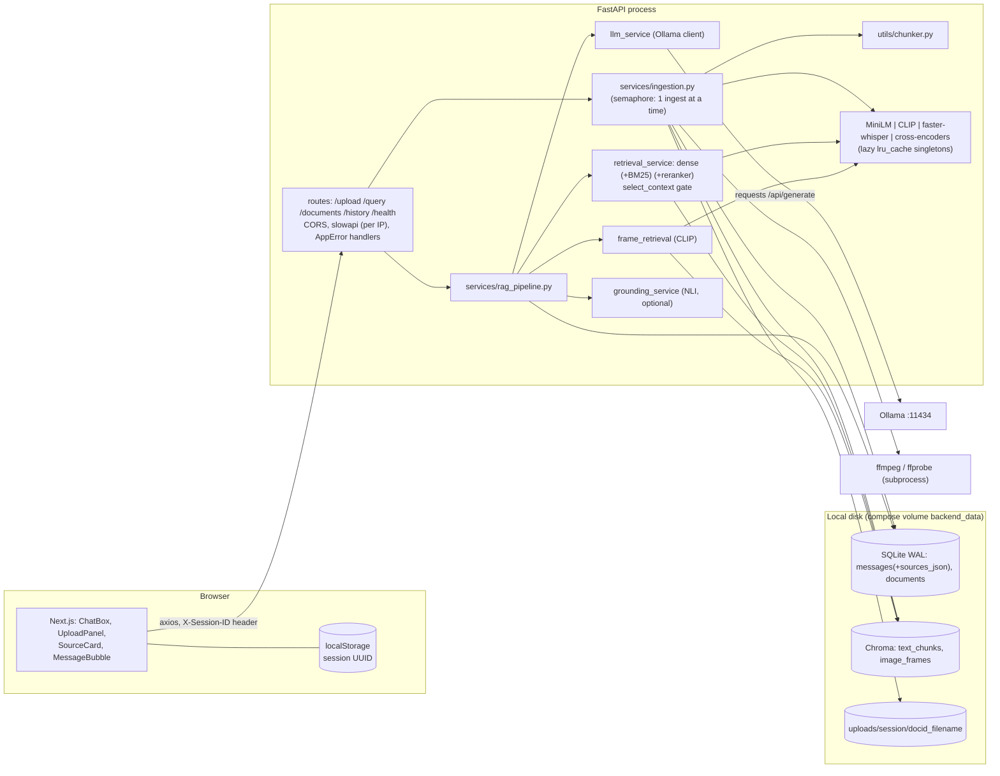

# LectureMindAI — Deep Technical Walkthrough (v2, re-analysed after the repo changed)

**Repository:** `MahathiVarikuti/LectureMindAI` (checkout at `/home/user/LectureMindAI`)
**Commit analysed:** `302cd6e1420dd0d0072f6ee3b0bbcef66824ec9e` — "fix(retrieval): blend reranker with hybrid ranking and gate on best chunk; rewrite README with screenshots", 2026-10-30. This is the tip of `origin/main` (I ran `git fetch`). My previous walkthrough analysed `8e37e56`; since then `main` gained ~40 commits and the backend was **restructured and largely rewritten**, so everything below was re-read from scratch.
**History:** 44 commits. Authors by commit: 24 "Varikuti Mahathi Reddy", 12 "Claude", 8 "Adv-2005" (May–June 2026 — the original v1). Many of your commits carry `Co-Authored-By: Claude Sonnet 5.5` (later) or `Co-authored-by: Copilot` (earlier) trailers. [Verified: `git log`]
**Stack hint / audience:** none given; I infer Python/FastAPI + Next.js + RAG and write for an SDE / ML-backend interview and code review.

### Label key
`[Verified]` read in source · `[Measured]` I ran it (or read it from a result file/CI log, stated) · `[Documented only]` docs/README claim not backed by code · `[Partial]` · `[Not found]` · `[Inferred]` reasoned, not executed · `[Needs your confirmation]`

### What I ran (read-only)
- `python3 -I` scripts in my scratchpad that load the **real source** of `utils/chunker.py`, and AST-extracted pure functions of `rag_pipeline.py`, `retrieval_service.py`, `llm_service.py`, `grounding_service.py`, `utils/media.py`, with a stubbed `app.config`. Results marked `[Measured]`.
- I read GitHub Actions run metadata and one failed job's log via the GitHub API tools (read-only) to see what CI actually does. Results marked `[Measured: CI]`.
- I read the committed evaluation JSON files in `backend/eval/results/` to check the README's benchmark table.
- **I did not run pytest, the server, Ollama, Whisper, CLIP, Chroma or the frontend** (no dependencies installed; I was told not to install). All model-quality statements are therefore `[Inferred]` or taken from the repo's own result files, which I treat as the author's claims.

---

# 0. What changed since my previous analysis (`8e37e56` → `302cd6e`)

| Previous finding | Now |
|---|---|
| LLM saw only `snippet[:300]` of each 1000-char chunk | **Fixed.** `format_context` uses full `chunk["text"]` (`llm_service.py:81-92`); the UI still truncates to 300 chars for display only (`SourceCard.tsx`). |
| Relevance = min-max inside the result list (best hit always 1.0) | **Fixed.** Scores are absolute: cosine similarity (or reranker probability) with a threshold on the **best** chunk (`retrieval_service.py:187-211`). |
| Blocking sync work inside `async def` | **Mostly fixed.** Ingestion and queries run via `run_in_threadpool` (`routes/upload.py:67`, `routes/query.py:45`); a semaphore serialises heavy ingests (`ingestion.py:24-35`). Small sync calls (SQLite, file writes) remain on the event loop. |
| Whole upload buffered 3× in RAM by a body-sniffing middleware | **Fixed.** Middleware deleted; uploads stream to disk in 1 MB blocks with size/quota checks as bytes arrive (`routes/upload.py:21-37`). |
| Rate limit keyed by client-chosen session id | **Fixed.** Keyed by client IP (`limiter.py:8`). |
| `/upload-url` SSRF risk / yt-dlp | **Removed** (feature deleted; `TASKS.md:12`). |
| Résumé-specific `SECTION_HEADER_RE` and keyword "intent" heuristics | **Replaced** by a generic ALL-CAPS-heading chunker; intent keywords deleted. (Résumé *test fixture* remains.) |
| Chat sources not persisted | **Fixed.** `messages.sources_json` (`db/sqlite.py:52-53`). |
| `print` debug of user queries | **Fixed.** No `print(` in `backend/app` (grep). |
| Errors returned `str(e)` | **Mostly fixed.** `AppError` + a generic 500 handler (`main.py:47-55`); some `AppError` messages still embed library/ffmpeg text. |
| Orphans / silent vector-delete failure | **Improved.** Purge on ingest failure (`ingestion.py:142-144`), `reconcile_orphans()` at startup, delete is vectors→file→row and errors propagate. One new leak found (§4.4 #4). |
| Scanned PDF → "success, 0 chunks" | **Fixed.** 422 "No extractable text…" (`ingestion.py:138-139`). |
| No CI, no Dockerfile hygiene | **CI added — and it is red** (§4.3). Healthcheck + `.dockerignore` added; still root user, unpinned deps. |
| Personal résumé + Chroma binaries committed | Removed from the tree, **still in git history** (§4.1). |
| **New:** evaluation harness + fine-tuned reranker/NLI/embedder, hybrid BM25, RRF fusion, citation alignment, duplicate detection, startup reconcile. |

---

# PART 1 — WHAT IT DOES

## 1.1 Purpose
A student uploads **PDFs, audio or video** and asks questions in a chat UI. The backend extracts/transcribes, chunks, embeds and indexes the content; for each question it retrieves the best chunks (plus matching video frames), asks a small **local LLM via Ollama** (`qwen2.5:1.5b` by default) to answer *only* from them with `[n]` citations, and returns the answer with sources (PDF page, audio/video time range, video frame time). Identity is a browser-generated UUID, not a login. [Verified: `README.md`, `routes/*`, `frontend/src/lib/session.ts`]

Design goals stated by the author (`README.md:9-13`): every answer traceable; refuse rather than guess; run on a CPU laptop; measure with public benchmarks.

**Core workflow:** upload (stream to disk, hash, dedupe) → extract/transcribe/sample frames → chunk → embed → Chroma + SQLite row → ask → (rewrite follow-up) → retrieve (dense, optional BM25 + reranker) → best-chunk gate → LLM → citation alignment → optional NLI check → persist turn with sources.

## 1.2 Verified technology inventory

| Technology | Status | Evidence |
|---|---|---|
| FastAPI + Uvicorn, pydantic-settings, slowapi | **Used** | `main.py`, `config.py`, `limiter.py` |
| SQLite (stdlib), WAL | **Used** | `db/sqlite.py:68-80` |
| ChromaDB `PersistentClient`, 2 cosine collections | **Used** | `db/chroma.py` |
| sentence-transformers MiniLM (`all-MiniLM-L6-v2`) text embeddings | **Used** | `embedding_service.py` |
| CLIP `openai/clip-vit-base-patch32` via `transformers` (not open_clip any more) | **Used** | `clip_service.py` |
| faster-whisper (`base`, CPU int8) + **ffmpeg decode** | **Used** | `transcription.py:12-43` |
| PyMuPDF (`sort=True`) | **Used** | `pdf_service.py:12` |
| rank-bm25 hybrid search | **Used only if `USE_HYBRID=1`** (default off) | `retrieval_service.py:16,90-141` |
| Cross-encoder reranker (`ms-marco-MiniLM-L-6-v2`, or a locally fine-tuned one) | **Used only if `USE_RERANKER=1`** (default off) | `config.py:57`, `retrieval_service.py:44-53` |
| NLI grounding check (`nli-deberta-v3-small`) | **Used only if `USE_GROUNDING_CHECK=1`** (default off) | `grounding_service.py` |
| Ollama over HTTP via `requests`, `stream:false` | **Used** | `llm_service.py:47-71` |
| Next.js 16.2.6 / React 19.2.4 / Tailwind 4 / axios / react-markdown | **Used** | `frontend/package.json` |
| Docker + compose (now includes an `ollama` service) | **Present; not built by me**; README says not verified end-to-end | `docker-compose.yml` |
| GitHub Actions CI | **Present, currently failing** | `.github/workflows/ci.yml`, §4.3 |
| Evaluation harness + fine-tuning scripts (QASPER, SQuAD v2, CoQA, RAGTruth, RAGBench) | **Present** (`backend/eval/`, not in Docker image) | `eval/run.py` |
| yt-dlp / URL import | **Removed** (`requirements.txt` has no yt-dlp) | `TASKS.md:12` |
| FAISS | **[Not found]** anywhere in code | `git grep` |
| Streaming responses | **[Not found]** (`stream:false`, `llm_service.py:62`; `README.md:386` lists it as future work) | |
| Authentication / accounts | **[Not found]** by design (`docs/security.md`) | |
| OCR for scanned PDFs | **[Not found]** (rejected with 422) | |
| DB migration framework | **[Not found]**; one ad-hoc `ALTER TABLE ADD COLUMN` (`db/sqlite.py:50-53`) | |
| `torchvision` in requirements | **Installed, no direct import** (likely transitive for CLIP image processing) | `requirements.txt:4` |
| LICENSE | **[Not found]** (README says none chosen) | |

**Fine-tuned model weights** (`backend/models/`) are git-ignored and **not in the repo** (`.gitignore:13`; `git ls-files` shows none). So the best-quality profile in the README cannot be reproduced without training them locally (~20 min CPU per README).

---

# PART 2 — ARCHITECTURE AND JOURNEYS

## 2.1 Style
A **client–server modular monolith**: one Next.js client, one FastAPI process that does HTTP, CPU-bound ML inference in-process and storage; the only separately-run service is **Ollama** (compose adds it as its own container). No evidence of independently deployed application services, so "microservices" would be wrong. Layers: `routes/` (HTTP) → `services/` (ingestion, rag_pipeline, retrieval, llm, grounding, transcription, clip) → `utils/` (chunker, media) → `db/` (sqlite, chroma). [Verified]

## 2.2 Component diagram



## 2.3 Query sequence (default configuration)

```mermaid
sequenceDiagram
  participant U as Browser
  participant A as POST /query
  participant S as SQLite
  participant O as Ollama
  participant E as MiniLM/CLIP (in-process)
  participant C as Chroma
  U->>A: {query, session_id, selected_documents[]} + X-Session-ID
  A->>A: validate UUIDv4, model allow-list, non-empty, <=2000 chars, doc ownership
  A->>S: last 10 messages
  opt history and (<=4 words or follow-up pronoun)
    A->>O: rewrite to standalone question (errors -> original query)
  end
  A->>E: embed query (MiniLM)
  A->>C: text_chunks.query(top 20, where session_id [+doc ids])
  A->>A: select_context: best score >= 0.15? keep top 4
  A->>C: image_frames: only if session has frames -> CLIP text embed, top 3, cosine >= 0.2
  alt no text chunk passes
    A-->>U: "not found" (no LLM) -- or a frame listing if frames matched
  else
    A->>O: system prompt + numbered passages + question
    O-->>A: answer
    A->>A: is_not_found? align_citations; optional NLI check
  end
  A->>S: append user + assistant(+sources)
  A-->>U: answer, sources, rewritten_query, abstained, flagged, context, timings, used_documents
```

## 2.4 Where state lives

| State | Where | Notes |
|---|---|---|
| Session identity | `localStorage["lecturemind_session_id"]` (`session.ts:3-13`) | lose it = lose access |
| Selected docs, in-flight messages, upload status | React state (`ChatBox.tsx`) | |
| Documents (owner, path, size, SHA-256, chunk_count) | SQLite `documents` | unique `(session_id, file_hash)` |
| Chat turns + the sources of each answer | SQLite `messages` | capped at 500/session on every insert |
| Chunk text + embeddings + metadata | Chroma | metadata has `session_id`, `document_id`, page/timestamps |
| Original files | `uploads/<session>/<docid>_<name>` | |
| Models | process memory (`lru_cache`) | lost on restart; HF cache on volume in Docker (`Dockerfile:16`) |
| Rate-limit counters | slowapi in-memory `[Inferred]` | per process, reset on restart |
| BM25 index (only with hybrid) | process memory in `Retriever._bm25`, rebuilt after any upload/delete | spans **all sessions** |

## 2.5 Journey A — upload a PDF
1. UI: `UploadPanel.onFile` → `uploadFile` posts `FormData{file, session_id}` with **no client timeout** (`api.ts:72-78`).
2. `upload()` (`routes/upload.py`): validate UUIDv4; `safe_filename` (strip path, replace unsafe chars, cut to 150); modality by **extension**; `check_can_accept` (≤20 docs) *before* reading bytes.
3. `_save_stream`: 1 MB blocks to `uploads/<session>/<uuid>_<name>`, hashing SHA-256, aborting with 413 if > 25 MB (PDF) / 500 MB (media) or if the session quota (500 MB) would be exceeded.
4. PDF magic check (`%PDF-` in first 1 KB). Duplicate by hash → delete the new file, return the existing doc with `duplicate:true`.
5. `run_in_threadpool(ingest_pdf…)`: take the ingestion semaphore (wait ≤120 s else **503 "server busy"**); PyMuPDF → `chunk_pages` → if no chunks **422**; embed all chunks in one batch; add to Chroma in batches of 500; insert the SQLite row; invalidate the BM25 index.
6. Any exception → `purge_vectors(document_id)`; the route deletes the stored file (`except BaseException`, `upload.py:80-83`).
7. UI shows the message and refreshes `/documents`.
**What the user sees on failure:** the server's `detail` string (e.g. "Unsupported file type…", "The file is not a valid PDF.", "No extractable text found. The PDF may be scanned images (needs OCR)."). Rate limit (5/min/IP) → UI maps 429 to "Too many requests…" (`api.ts:56`).

## 2.6 Journey B — upload a video
`ingest_video` (`ingestion.py:172-199`): `ffprobe` duration (≤30 min, **before** the slot) → temp work dir → ffmpeg extracts 16 kHz mono WAV → faster-whisper (ffmpeg-decoded float array, `beam_size=1`, VAD on, wall-clock deadline `WHISPER_TIMEOUT=900 s`) → `chunk_segments` (timestamps kept) → embed+store as `video_transcript` → ffmpeg samples a frame every 7 s (scaled to 360 px, capped at `duration/7 + 2`) → CLIP embeds frames in batches of 16 → `image_frames` → SQLite row (`modality="video"`, `chunk_count = text + frames`) → `rmtree(work)` in `finally`. Failure anywhere → purge vectors. A video with **no audio track** fails (`extract_audio` raises 400) — there is a `with_frames` parameter but no frames-only fallback and the route never sets it `[Verified path; ffmpeg behaviour Inferred]`.

## 2.7 Journey C — ask a question
See §2.3. UI: `ask()` pushes the user bubble, shows "Reading your material…", then renders the answer via `react-markdown`, a "Not in your material" badge if `abstained`, and `SourceCard`s numbered `[1..n]`. Errors: backend `AppError` detail → bubble text + a dismissible banner (both, so the error shows twice).
Failure/edge behaviour:
- Ollama down → `requests.RequestException` → **503** "…(Ollama) is unavailable. Is it running?"; timeout → **504** (`query.py:46-49`). A missing model (Ollama returns 404) also surfaces as 503 with the same "is it running?" text `[Inferred]`.
- On any error nothing is persisted — the user's question vanishes from history (the UI shows an error bubble only).
- Not-found via gate → fixed sentence, no LLM; via the LLM replying with the exact sentence → `abstain_reason="llm_not_found"`; **sources are still returned in both LLM-refusal cases** (`rag_pipeline.py:98-110,133-136`), so the UI can show "Not in your material" with source cards beneath. (In the *gate* case the sources list holds only frames.)
- Text abstains but frames match → a canned list of video moments, `abstained:false`, no LLM (`rag_pipeline.py:111-125`).

## 2.8 Journey D — delete, history, reload
- `DELETE /documents/{id}`: ownership check (404 identical for unknown vs foreign id) → delete vectors in both collections → invalidate BM25 → unlink the file only if it resolves inside `uploads/<session>/` → delete SQLite row **last** (`routes/documents.py:27-42`). A failure mid-way leaves the row, so the user can retry (idempotent). [Verified]
- `GET/DELETE /history`: returns/clears messages with their persisted sources. After reload the UI restores sources but **not the `abstained` flag** (`ChatBox.tsx:49-51` maps only role/content/sources), so the "Not in your material" badge disappears.
- Auth journey: none (Part 4.1).

---

# PART 3 — CORE LOGIC IN DEPTH

## 3.1 Chunking (`utils/chunker.py`)

**PDF text → chunks** (`chunk_pages`, `:155-170`): for each page, clean text; take the **first line that "looks like a heading"** (≤12 words, ≤120 chars, and either ALL-CAPS or not ending in `. ? ! ; :`) as the running heading, remove it from the page body, chunk the rest, then prefix every chunk with the (possibly carried-over) heading. `chunk_text` (`:116-145`) additionally splits at **ALL-CAPS heading lines** (`_is_heading`: ≥4 letters, `isupper()`, ≤6 words, not a bullet, not ending in punctuation), keeps each "entry" (title + stack line + bullets) together via `_units`/`_starts_new_entry`, and recursively splits oversize units on `\n\n, \n, ". ", "? ", …, " "` and packs with ~200-char sentence overlap (`_pack`). Chunks shorter than `MIN_CHUNK_CHARS=40` are **dropped silently**.
Measured behaviours `[Measured]`:
- `tests/resume_sample.txt` → 9 chunks, each section heading-prefixed; the three projects are separate chunks (what `TestSectionAwareChunking` asserts).
- A lecture-like text where `SQL` (3 letters) isn't treated as a heading gets merged into the previous section (heading needs ≥4 letters).
- `chunk_text("Hello world.")` → `[]` (12 chars < 40). A PDF whose pages are all tiny text produces "No extractable text" even though text exists.
- `chunk_pages` heading heuristic is noisy: a page starting with a page number (`"12"`) or a wrapped sentence fragment ("with respect to every weight in the network") becomes the "heading" that prefixes that page's chunks (no text is lost, but the prefix is misleading, and a page without any heading-like line inherits the previous page's prefix).
- Designed for résumés and structured papers; for slide decks with title-case headings only the first-line heuristic helps.
**Transcripts** (`chunk_segments`, `:184-216`): greedily pack Whisper segments ≤1000 chars; the next chunk restarts with trailing segments up to 200 chars (true overlap); each chunk carries `[first.start, last.end]`. `[Measured]` 12 segments of 150 chars → 3 chunks with time ranges (0–59 s), (50–109 s), (100–119 s). A single segment longer than 1000 chars is **not** split (fine for Whisper's short segments).
`chunk_text_fixed` (`:173`) is the old V1 character window kept only as an evaluation baseline.

## 3.2 Embeddings and stores
- Text: MiniLM, `normalize_embeddings=True` (`embedding_service.py:24-33`), 384-d. A BGE-style query instruction is added only if the model name contains "bge".
- Frames: CLIP image embeddings L2-normalised; the CLIP **text** encoder embeds the query for text→frame matching (`clip_service.py`). Query truncated to 77 tokens.
- Two Chroma collections with cosine space; IDs `<docid>_<i>` and `<docid>_frame_<i>`; metadata omits `None` values.
- Scores: Chroma returns distance; `score = 1 - distance` (cosine similarity) (`retrieval_service.py:119`, `frame_retrieval.py:30`).

## 3.3 Retrieval pipeline (`Retriever.retrieve`, `retrieval_service.py:143-184`)
1. **Dense:** top `candidate_k=20` by cosine, filtered by `where = session_id [AND document_id IN …]` (`db/chroma.py:37`).
2. **Sparse (if `USE_HYBRID`):** BM25Okapi over *all* chunks in the collection (index built once, rebuilt after any upload/delete), stopword-stripped tokens; results filtered afterwards by session/document. BM25 hits that dense search didn't return are tagged `sparse_only` and **never** reach the LLM or satisfy the gate (they have no cosine score).
3. **Fusion:** Reciprocal Rank Fusion, `rrf += 1/(60 + rank + 1)` per list.
4. **Rerank (if `USE_RERANKER`):** cross-encoder scores `(query, chunk)` for every candidate; logits → sigmoid → 0–1. Then, because one erratic reranker score can bury the right chunk, a **weighted RRF of the hybrid order and the reranker order**: `fused = 1/(60+hybrid_rank+1) + 2/(60+rerank_rank+1)` (weight `RERANK_FUSION_WEIGHT=2`). `[Measured: arithmetic]` with 4 candidates where the reranker prefers `h3` over `h0`: fused h0=0.04865 > h3=0.04841 → the hybrid winner stays first. Higher weights let the reranker override.
5. Without reranker: `score = dense cosine` (BM25-only → neutral 0.15).
**Defaults matter:** `USE_HYBRID=False`, `USE_RERANKER=False`, `USE_GROUNDING_CHECK=False` (`config.py:56-62`) → the out-of-the-box system is **dense MiniLM only**. Hybrid/reranker/NLI are opt-in features from the evaluation work.

## 3.4 The relevance gate (`select_context`, `:187-211`)
```python
best = max(c["score"] for c in eligible)          # eligible = not sparse_only
if best < threshold: return [], "low_relevance"
floor = max(threshold, best*cutoff) if per_chunk_threshold else best*cutoff   # cutoff = 0.05
kept = [c for c in candidates[:top_k] if not c.get("sparse_only") and c["score"] >= floor]
```
`rag_pipeline` passes `per_chunk_threshold=False`, so the threshold gates only the **best** chunk, and the top-4 (≥5% of best) go to the LLM. Threshold defaults: **0.15 cosine** (dense) or **0.125** (stock reranker); `RELEVANCE_THRESHOLD` env overrides; README recommends 0.30 with the fine-tuned reranker. `[Measured]` examples: best 0.14 → abstain; scores `[0.16, 0.01, 0.0, 0.0, 0.9]` where the 0.9 chunk is *outside* `candidates[:4]` → gate passes using 0.9 but the kept list is only the first chunk (a constructed case; in dense-only mode candidates are score-sorted so it doesn't arise, in hybrid/fused order it could).
**Honest limits (author's own numbers):** README admits the gate "separates unrelated questions well on general text but poorly when a question is about an uploaded document that does not answer it" (`README.md:358`); `docs/evaluation.md:193-201` reports out-of-corpus AUROC 0.979 (SQuAD) vs **0.63 (QASPER)** and in-corpus-unanswerable AUROC 0.60–0.70. The shipped 0.15 is deliberately lower than the benchmark-optimal 0.30 to avoid false refusals on real PDFs (`evaluation.md:108-113`).

## 3.5 Frames
`retrieve_frames`: skip entirely if the session has no frames (so CLIP isn't loaded); otherwise CLIP text embedding → top 3 → keep `score >= 0.2` (absolute raw cosine; typical matches 0.2–0.35). Frames get their own labelled section in the prompt ("Visually related video frames (images, no text)" + filename/time) and are always kept in the sources. **The LLM never sees pixels** (text-only 1.5B model), so cross-modal retrieval = "surface a timestamp".

## 3.6 Prompting and rewriting (`llm_service.py`)
- **System prompt** (8 rules): use only numbered passages; cite `[n]`; answer partial matches; refuse with the exact sentence only if *no* passage relates; list *every* item for list questions; answer *every part* of multi-part questions. The rules were tuned empirically to counter a small model's over-refusal and partial answers (commit history).
- `generate_answer`: context = `[i] (file, page N | hh:mm:ss-hh:mm:ss)\n<full chunk>` blocks; `temperature=0`, `num_ctx=8192`, timeout 120 s.
- **Rewrite** (`rewrite_query`): only when history exists **and** (`len(query.split()) <= 4` or a follow-up word matches `_FOLLOW_UP`) (`:121-124`). `[Measured]` "What is gradient descent?" with history → rewrite (≤4 words) even though it's standalone; "Explain backpropagation in detail please" → no rewrite. `_clean_rewrite` strips "Rewritten question:" and falls back to the original if the model answered instead of rewriting (output >3× original or >200 chars). Failure → original query.
- `is_not_found`: exact-sentence match after stripping citations/punctuation (`:114-118`); a refusal with extra words is **not** recognised as a refusal `[Measured]`.

## 3.7 Citation alignment (`rag_pipeline.align_citations`, `:42-63`)
Keeps only the **text sources the answer actually cites**, renumbers them 1..n in order of first use, rewrites the markers in the text, and always keeps video-frame sources. If no valid marker is present, returns everything unchanged.
`[Measured]` **Bug:** the regex `\[(\d+(?:,\d+)*)\]` also matches code indexing. With at least one real citation present, `"Use arr[0] to read the first item [2]. Then arr[1] gives the next [3]."` becomes `"Use arr to read the first item [1]. Then arr[2] gives the next [3]."` — `arr[0]` is **deleted** (0 isn't a valid source number so the rewrite returns `""`) and `arr[1]` is **renumbered** to `arr[2]`. For CS lecture content this silently corrupts answers.

## 3.8 Grounding check (optional) (`grounding_service.py`)
Answer → sentences (citations stripped, bullets trimmed); a sentence is a "claim" if ≥4 words and not ending in `:`. For each claim: NLI entailment probability against **each retrieved chunk** (max over chunks) with an additional **lexical shortcut** (≥72% of the claim's non-stopword tokens present in one chunk, claims with ≥5 tokens). `supported = prob >= 0.5 or lexical`; `groundedness = supported/total`; `flagged = groundedness < 0.6`. `[Measured]` the lexical helper: a near-verbatim sentence → True; "invented by Newton in 1687" → False; a correct but unrelated claim → False. The flag is **returned but never used by the UI** (`QueryResponse.flagged` exists in `api.ts`; `ChatBox` ignores it). The author's own numbers: moderate (best F1 ≈0.5; at threshold 0.6, precision ≈0.2 per `evaluation.md:64-66`).

## 3.9 Ingestion invariants and integrity
- **Idempotency:** content hash per session + unique partial index `(session_id, file_hash)` (`db/sqlite.py:37-38`); a pre-check plus an `IntegrityError` handler covers concurrent duplicates.
- **Write order (PDF/audio/video):** file on disk → vectors → SQLite row. Failure after vectors → purged in `except`. A crash *between* vectors and row (kill -9) leaves orphan vectors; `reconcile_orphans()` at startup removes vectors whose document has no SQLite row (`ingestion.py:63-75`). **Not reconciled:** files on disk with no row, rows whose vectors are missing, `chunk_count` drift.
- **Delete:** vectors → file → row (safe order).
- **Concurrency:** `BoundedSemaphore(1)` serialises heavy ingestion; per-session count/storage checks are check-then-act and don't count in-flight uploads (two simultaneous uploads can both pass). Queries aren't serialised (`lru_cache` model loading has no lock, so two simultaneous first queries could load a model twice `[Inferred]`).
- **Undo:** none (deletes are permanent; "New conversation" wipes history permanently).

## 3.10 Data model
```
messages(id PK AUTOINCREMENT, session_id NOT NULL, role CHECK(user|assistant), content NOT NULL,
         created_at NOT NULL, sources_json TEXT  -- added by ALTER TABLE)   IDX(session_id)
documents(document_id PK, session_id NOT NULL, filename NOT NULL, modality NOT NULL, file_path,
          file_size NOT NULL DEFAULT 0, file_hash, chunk_count NOT NULL DEFAULT 0, uploaded_at NOT NULL)
          IDX(session_id)  UNIQUE IDX(session_id, file_hash) WHERE file_hash IS NOT NULL
```
[Verified `db/sqlite.py:15-53`]. No foreign keys/cascades; ownership = `session_id` column. `add_message` prunes to the newest 500 rows per session on every insert (`:92-96`). SQLite connections are per-call, WAL mode, `timeout=30`. **Isolation:** every SQLite statement filters by `session_id`; every Chroma query/delete includes `session_id` in the `where`; BM25 results are post-filtered by session. A guessed `document_id` alone is useless (needs the owner's session; foreign and unknown ids return identical 404s — tested in `test_api.py::TestSessionIsolation`). **The real weakness is that the session UUID *is* the credential.**

## 3.11 API inventory

| Method + path | Auth | Validation | Success | Errors | Rate limit | Tested |
|---|---|---|---|---|---|---|
| `GET /health` | – | – | `{"status":"ok"}` | – | none | yes |
| `POST /upload` multipart `file`, `session_id` | UUIDv4 | extension allow-list, `%PDF-` magic, size/quota streaming, count limit, ffprobe for media | `{document_id, filename, chunks, modality, message}` (+`duplicate`) | 400/413/422/503/504/500 | 5/min/IP | yes |
| `POST /query` JSON `query(≤2000), session_id, selected_documents?, model?` | UUIDv4; `model` ∈ allow-list; selected docs must be owned | non-empty | `{answer, rewritten_query, abstained, abstain_reason, top_score, sources[], context, grounding, flagged, timings, used_documents}` | 400/404/503/504 | 10/min/IP | yes |
| `GET /documents` | header `X-Session-ID` (query param still accepted) | UUIDv4 | `[{document_id, filename, modality, chunk_count, uploaded_at}]` | 400 | none | yes |
| `DELETE /documents/{id}` | same | ownership | `{message, document_id, filename}` | 400/404 | none | yes |
| `GET /history`, `DELETE /history` | same | | `{messages:[{role,content,created_at,sources}]}` | 400 | none | partly |
Design notes: session id now travels in the **header** for GET/DELETE (fixes the URL-logging issue) but POST bodies also carry it and the query-param form remains for compatibility; no `/v1`, no pagination on `/history` (capped at 500/session instead); error format is consistently `{"detail": …}` (429 comes from slowapi's own handler `[Inferred]`, the UI special-cases it); `/query` returns the whole `context` and `timings`, which the UI ignores.

---

# PART 4 — BUGS AND LIMITS

## 4.1 Auth & security
**Identity:** browser `crypto.randomUUID()` in `localStorage` → sent on every request → server checks it's a UUIDv4 and scopes all reads/writes. No issue/expire/refresh/revoke. `docs/security.md` is candid that it's "not authentication". [Verified]

**Resolved since last time:** SSRF surface (URL import removed), body-sniffing/RAM amplification (streamed uploads), spoofable rate-limit key, debug logging of queries, path handling (`safe_filename`, delete confined to the session folder: `routes/documents.py:38-41`; `[Measured]` `../../etc/passwd` → `passwd`, `..\..\x.pdf` → `x.pdf`), upload content checks (PDF magic bytes; ffprobe must parse media), model allow-list.

**Confirmed issues**
1. **The session UUID is a bearer secret.** Anyone who gets it (shared computer, a proxy that logs it) can read the chat, list/delete documents. It's still accepted in query strings and POST bodies, so integrations or manual use can leak it into logs.
2. **No global resource cap; sessions never expire.** A client can mint unlimited UUIDs, each with its own 20 docs / 500 MB, limited only by 5 uploads/min/IP. No TTL cleanup of abandoned sessions; disk grows unbounded. (IP limiter also collapses all users into one bucket behind a reverse proxy — documented in `limiter.py`.)
3. **Quota/count checks are racy** (check-then-act, in-flight uploads uncounted).
4. **Personal data and binary DBs live in git history.** `git log --all --name-only` shows `backend/audit_output.txt` and `backend/live_audit_results.txt` (they contain a full résumé with contact details and a local Windows path) and early `backend/chroma_db/*` binary files (vector DB from the original contributor's local runs). They were removed from the tree but remain in history. If the repo is public, consider `git filter-repo` and rotate anything sensitive. I did not reproduce the contents.
5. **Some error strings still embed library output**: `AppError(500, f"Transcription failed: {exc}")`, `503 …CLIP could not be loaded: {exc}`, `400 Could not read audio…: {ffmpeg stderr[:200]}`.
6. **CORS**: restricted to `CORS_ORIGINS`; credentials auto-disabled with `*` (`main.py:41`) — correct.
7. **No LICENSE** file (README says so).

**Potential risks**
- **Prompt injection** via document text (no tools or cross-session data are reachable, so blast radius = that session's answer).
- **Resource DoS within limits:** 500 MB video uploads × many sessions; ffmpeg/ffprobe/PyMuPDF/Whisper parse untrusted files as root in the container.
- **BM25 index spans all sessions** (when hybrid is on): post-filtered, but corpus statistics (IDF) mix tenants, and the whole corpus is loaded into memory/rebuilt after any upload/delete anywhere.
- **XSS:** low (`react-markdown` doesn't render raw HTML; snippets render as text).
- **CSRF:** not applicable (no cookies/ambient credentials).
- **Secrets:** none in the repo (`git grep`); config via env/`backend/.env`. `.env.example` has variable *names* only.
- **Docker hygiene:** container runs as root; Python deps unpinned (`requirements.txt` has no versions); `ollama/ollama:latest` unpinned; no frontend healthcheck; `depends_on` doesn't wait for health.

## 4.2 Performance, scalability, reliability
**Per query (default config):** rewrite LLM call (conditional) + MiniLM embed + Chroma ANN + (if frames) CLIP text embed + LLM generation (dominant; up to 120 s on a CPU) + (optional) BM25 + reranker over 20 candidates (author measured ≈1.0–1.5 s/query in `eval/results/*.json`) + (optional) NLI over claims×chunks. Timings are returned in the response (`timings`) but never logged.
**Per ingest:** PDF = PyMuPDF + one MiniLM batch; audio/video = ffmpeg decode + Whisper (CPU, `base`, greedy) + embedding; video also up to `duration/7+2` frames through CLIP in batches of 16.
**Confirmed limits/bottlenecks**
- One heavy ingestion at a time (by design); a second upload waits up to 120 s then gets 503; the HTTP request stays open throughout (no job ID/progress; the UI uses `timeout: 0`).
- Small sync calls inside `async def upload` (`sqlite.total_storage`, file writes) run on the event loop; fine at this scale.
- SQLite per-call connections + `PRAGMA journal_mode=WAL` each time; `messages` pruning DELETE with a subquery per insert.
- Hybrid mode: BM25 rebuild is O(total chunks across all sessions) after each upload/delete.
- `reconcile_orphans()` at startup loads **all** vector metadata (`collection.get`) — O(N) startup.
- Single-process design: `lru_cache` singletons, Chroma `PersistentClient`, in-memory limiter ⇒ not safe for multiple Uvicorn workers/replicas.
- Models lazy-load on first use (slow first request); HF cache is on the compose volume, so containers don't re-download.
**At 10×:** move ingestion to a worker queue (status endpoint/SSE), run Ollama on a GPU box with streaming (`stream:true` + SSE), thread-safe model loading, Redis rate limiting, pinned images. **At 100×:** Postgres + object storage (S3) instead of SQLite/disk, server-mode vector DB (Qdrant/pgvector) with tenant filter in the index, real auth + per-user quotas/TTL, metrics/tracing.

## 4.3 Testing & operations

**What exists** (`backend/tests`; 54 `def test_` of which 1 is `@pytest.mark.slow` and deselected by `pytest.ini`):
| File | What it really proves |
|---|---|
| `test_api.py` (29) | with a **fake embedder, fake LLM, fake Whisper/CLIP**: CORS restriction, UUIDv4 validation, header-vs-query session, upload limits (type, fake PDF, size, count, storage), duplicate + concurrent-duplicate upload, model allow-list, duration check before transcription, PDF/audio/video round trips (citation page/timestamps, frames in a separate labelled section, frames-only answers without the LLM), session isolation (list/delete/query/selected_documents), chat history persistence/clear, vector+file deletion, orphan reconcile, irrelevant query skips LLM, rewrite plumbing, 503/504 mapping, 429 rate limit |
| `test_rag_primitives.py` (13) | `select_context` rules, sparse-only can't pass the gate, `_source`, `is_not_found`, `align_citations` (4 cases) |
| `test_chunking_and_utils.py` (11) | chunker (incl. résumé sections regression), segments, session-id validation, modality, `safe_filename` |
| `test_slow_smoke.py` (1, slow) | real MiniLM PDF smoke |
**Not covered:** real retrieval quality/ranking, hybrid/reranker/NLI paths, Ollama client behaviour, grounding logic, `align_citations` on code-like `[0]`, the duplicate-race file leak, `reconcile` for files, frontend (no tests; CI only lints + builds).
**Safe to run?** Yes: a temp dir for uploads/Chroma/SQLite, env vars set before importing the app, and `conftest.py` forces hybrid/reranker/NLI **off** regardless of a developer's `.env`. Needs the Python deps (torch etc.) installed because app modules import them lazily only partly — `fitz`, `numpy`, `chromadb`, `slowapi` are imported at module level.

**CI status `[Measured: CI]` — this is important.** `.github/workflows/ci.yml` runs a `backend` job (Python 3.11, installs CPU torch + all deps, `pytest`) and a `frontend` job (Node 20: `npm ci`, `npm run lint`, `npm run build`). The 8 most recent runs I retrieved (run numbers 6–13, including the head commit `302cd6e` on `main`) all concluded **failure**. I read the job log of the head run: **frontend job passes** (lint + build); **backend job: `1 failed, 52 passed, 1 deselected`**. The failing test is `tests/test_rag_primitives.py::RagPrimitiveTests::test_top_score_is_best_candidate` (`:60`): it uses a fake retriever returning a chunk scoring 0.8 (above its 0.1 threshold) and calls `answer_question(...)` **without the `llm` fixture**, so the pipeline proceeds to generation and makes a real HTTP call to `localhost:11434` → `ConnectionError`. It only passes on a machine with Ollama running. I did not inspect the logs of the older failed runs, so I can't say they failed for the same reason. README's "Backend tests: 53 pass" (`README.md:154`) is therefore true only with a local Ollama; **CI does not currently validate the repo.** Fix: pass `generation`-free path (monkeypatch `llm_service.chat`) or use the `llm` fixture.

**Prioritised test plan:** (1) fix the non-hermetic test (add `llm` fixture); (2) regression test for `align_citations` with `arr[0]`; (3) duplicate-race test asserting no leftover file in `uploads/<session>/`; (4) a table test for `select_context` in fused/hybrid order; (5) pipeline tests with a fake reranker covering fusion weights; (6) grounding unit tests with a stub NLI; (7) a long-filename upload test (see §4.4 #7); (8) frontend: Vitest + Testing Library for `errorMessage` (400/413/429/503/network) and history restore (incl. `abstained`); (9) a small hand-labelled lecture eval set run in CI nightly.

**Run/build/deploy (documented; not executed by me):** Python 3.11+, ffmpeg, Ollama + `ollama pull qwen2.5:1.5b`; `pip install -r requirements.txt`; `cp ../.env.example .env` (config reads `backend/.env`, `config.py:20`); `uvicorn app.main:app --port 8000`; `npm ci && npm run dev`; or `docker compose up --build` + `docker compose exec ollama ollama pull …`. README says "Docker Compose end to end on a clean machine" is **not verified** (`README.md:159`). Verified-by-author claims for real PDF/audio/video are in the README's status table `[Documented only]`. Common setup failures: ffmpeg/ffprobe missing (500), Ollama down or model not pulled (503), CORS origin mismatch, `NEXT_PUBLIC_API_URL` baked at **build** time, first-run model downloads, `RERANKER_MODEL=models/...` resolving relative to the working directory, unreleased fine-tuned weights.

## 4.4 Prioritised code review

| # | Finding | Actual behaviour | Impact | Fix | Trade-off |
|---|---|---|---|---|---|
| 1 | **CI red because of a non-hermetic test** (`test_rag_primitives.py:60`) | Test calls the real Ollama | No automated safety net; README test claim only true locally | Add the `llm` fixture / patch `chat` | none |
| 2 | **Headline benchmark claim doesn't describe the default build** (`README.md:156`) | README says QASPER hit@5 goes 0.20 → 0.39 "with the shipped settings", but shipped defaults are dense-only (no hybrid, no reranker) and the 0.39 row needs a fine-tuned reranker whose weights aren't in the repo. The committed retrieval JSONs contain **no run of the default `shipped_minilm` config** (`grep` shows it only in threshold files). The baseline vs final comparison also changes chunker, embedder, hybrid, reranker at once. | Misleading metric | Report the default config's number, or ship/host the weights; run an ablation | Needs another eval run |
| 3 | **`align_citations` corrupts code indices** (`rag_pipeline.py:39-63`) | `arr[0]` deleted, `arr[1]`→`arr[2]` `[Measured]` | Wrong answers in CS lectures | Only treat `[n]` as a citation when `1<=n<=len(sources)` **and** not preceded by an identifier/`)`; or use a distinct marker like `⟦n⟧` in the prompt | Prompt change for a small model |
| 4 | **Duplicate-race leaks a file** (`routes/upload.py:70-79`) | On the `IntegrityError` path the handler `return`s a duplicate response, bypassing the outer `except BaseException` cleanup, so the second copy `uploads/<s>/<newid>_<name>` stays on disk, uncounted in quota. The test only asserts one document row. | Slow disk leak | `os.remove(dest)` in that branch | trivial |
| 5 | **Relevance gate weak for in-corpus unanswerable questions** (own docs) | AUROC 0.60–0.70; relies on the 1.5B model to refuse (refuses only 20% of unanswerable per `README.md:264`) | "Grounded" claim overstated | Calibrate on real lecture data; larger model; stricter threshold; verify with NLI | More false refusals |
| 6 | **Sources shown under refusals** (`rag_pipeline.py:98-136`) | `llm_not_found` returns the retrieved sources; UI shows "Not in your material" plus cards | Confusing/misleading citations | Clear `sources` when abstained | – |
| 7 | **Long filenames break valid uploads** (`utils/media.py:18`) | `[:150]` truncation can cut off the extension; `[Measured]` a 300-char `a…a.pdf` → no extension → modality `None` → "Unsupported file type" | Rare UX bug | Truncate the stem, keep the extension | – |
| 8 | **Silent videos rejected** (`ingestion.py:180`, `media.py:63-72`) | No audio track → 400 even though frames could be indexed (`with_frames` exists, unused by route) | Lost feature | Fall back to frames-only | – |
| 9 | **`flagged`/`timings` computed but unused; `abstained` lost on reload** (`ChatBox.tsx:49-51`) | Dead UI paths; badge disappears after refresh | UX | Persist/return `abstained` per message; show grounding warning | schema change |
| 10 | **No unique-quota enforcement for concurrent uploads; no TTL for sessions** | See §4.1 | DoS/disk | Per-IP and global caps, TTL job | – |
| 11 | **Dual config sources** (`config.py:20-154`) | `settings.x` plus module-level `UPPERCASE` aliases snapshotted at import; tests patch one or the other | Subtle test/config bugs (e.g. changing `settings.use_reranker` at runtime doesn't affect `config.USE_RERANKER`) | One source | Refactor |
| 12 | **Retrieval ordering vs gate mismatch in fused mode** (`retrieval_service.py:206-210`) | Gate uses the max score over all candidates; context is `candidates[:4]` in fused order, which may exclude the max-score chunk `[Measured, constructed]` | Rare irrelevant context | Gate on the same set you pass | – |
| 13 | **Frontend polish**: `layout.tsx:19-20` still says "Create Next App"; error shown twice (banner + bubble); `key={i}` on messages; no live region for answers; custom CSS classes undocumented | UX/a11y | quick fixes | – |
| 14 | **Stale docs**: `docs/architecture.md:4` still says "upload panel (file or URL)"; `docs/PROJECT_WALKTHROUGH.md` (written for commit `efcda88`) still describes URL import/SSRF guard and "no CI"; README says `model` is "client-controlled" though an allow-list exists | Misleads reviewers | Update or delete | – |
| 15 | **Unpinned dependencies, root container, no lockfile for Python** | Non-reproducible builds | Ops | `pip-compile`, non-root user | – |
| 16 | **Heading heuristics are noisy** (`chunker.py:148-170`) | page numbers/sentence fragments become "headings" (§3.1) | Retrieval noise | Use PDF font sizes / outline | Complexity |

### What I'd do with another week
1. **Make CI green and honest** (fix the Ollama test, add the missing regression tests above) so every later change is protected.
2. **Make the benchmark claims match the product:** run the default config (`shipped_minilm`) and the "shipped" fused config under the same harness, publish both, and either host the reranker weights or make the README profile explicit. Add a 30–50 question hand-labelled set from real lecture PDFs.
3. **Fix correctness bugs cheaply:** `align_citations` code-index bug, duplicate-race file leak, long-filename truncation, sources-under-refusal, persist `abstained`.
4. **Harden operations:** pin deps, non-root containers, session TTL cleanup and global caps, structured logging of `timings`, and consider streaming answers (SSE).

---

# PART 5 — INTERVIEW / LEARNING MATERIAL

## A. Explanations

**2-minute version.** "LectureMindAI is a retrieval-augmented question-answering app for lecture material. You upload PDFs, audio or video; the FastAPI backend extracts text with PyMuPDF or transcribes speech with faster-whisper, chunks it in a structure-aware way, embeds it with MiniLM and stores it in ChromaDB with session and document metadata. Video frames are sampled every 7 seconds and embedded with CLIP in a second collection. A question is rewritten if it's a follow-up, embedded, searched within the user's session, and the best chunk's similarity is compared with a threshold: if nothing is relevant the API refuses without calling the model. Otherwise a local Ollama model answers using only numbered passages and cites them; I then keep only the sources it actually cited. Users are isolated by a UUID in the browser — deliberately no login. I also built an evaluation harness on public benchmarks and fine-tuned a reranker; the results are mixed and I report them honestly."

**5-minute version.** Add: (1) *Why local models*: cost/privacy, CPU-only; cost: weak 1.5B model that over- or under-refuses, so I tuned the prompt and measured. (2) *Why two collections*: MiniLM (384-d) and CLIP (512-d) live in different spaces and score on different scales (cosine ~0.3–0.8 vs ~0.2–0.35), so each is queried and thresholded separately; frames contribute timestamps only because the LLM is text-only. (3) *Retrieval*: dense by default; optional BM25 + RRF + cross-encoder; the final order is a weighted RRF of hybrid and reranker rank because a fine-tuned reranker mis-scored a short document — traded benchmark hit@5 0.45 → 0.39 for robustness. (4) *Safety*: UUIDv4 sessions filtered in SQLite and Chroma, per-IP rate limits, streamed uploads with size/quota limits checked early, magic-byte checks, duplicate detection by hash, purge-on-failure and startup reconciliation. (5) *Known gaps*: CI currently red because one test calls the real Ollama; the abstain gate is weak for questions about an indexed doc that doesn't contain the answer; citation alignment mangles `arr[0]`; benchmark claim vs default build.

## B. Five code walkthroughs

### B1. The relevance gate (`retrieval_service.py:187-211`)
```python
eligible = [c for c in candidates if not c.get("sparse_only")]
best = max(c["score"] for c in eligible)
if best < threshold: return [], "low_relevance"
floor = max(threshold, best * relative_cutoff) if per_chunk_threshold else best * relative_cutoff
kept = [c for c in candidates[:top_k] if not c.get("sparse_only") and c["score"] >= floor]
```
- `sparse_only` chunks (BM25 hits with no dense score) are excluded so a keyword match can't open the gate.
- Gate on the **best** chunk: refuse if even the closest chunk is irrelevant. `per_chunk_threshold=False` means we don't also drop weaker-but-useful chunks (cosine of the right chunk for "what are her projects?" is often only 0.15–0.3).
- `floor = best*0.05` is a near-no-op relative cutoff. Weak points: absolute thresholds depend on the embedder/reranker (0.15 cosine vs 0.125/0.30 reranker probability); gate set (all candidates) ≠ passed set (`[:top_k]`).

### B2. Fusing the reranker with the hybrid ranking (`retrieval_service.py:165-177`)
```python
scores = rerank_scores(query, [c["text"] for c in candidates], self.reranker_model)
for rank, (c, s) in enumerate(zip(candidates, scores)):
    c["score"] = s; c["hybrid_rank"] = rank
by_score = sorted(candidates, key=lambda c: c["score"], reverse=True)
if self.fuse_rerank:
    for rank, c in enumerate(by_score):
        c["fused"] = 1/(RRF_K + c["hybrid_rank"] + 1) + self.fuse_weight/(RRF_K + rank + 1)
    candidates.sort(key=lambda c: c["fused"], reverse=True)
```
- Candidates arrive in RRF (hybrid) order, so the loop index is each chunk's hybrid rank. The reranker's ranking is `by_score`. Final order = weighted sum of reciprocal ranks with weight 2 for the reranker.
- Why: an erratic reranker score (0.04 on the answer chunk in the author's job-description test) can no longer evict the right chunk. `score` stays the raw reranker probability, used for the gate and shown in the UI.
- Interview point: this is a classic rank-fusion ensemble trading peak accuracy for robustness; the author's ablation (`evaluation.md:221-231`) shows weight 2 → 11/12 on a hand test vs QASPER hit@5 0.39.

### B3. Streaming upload with dedupe and failure cleanup (`routes/upload.py`)
```python
file_hash, _size = await _save_stream(file, dest, max_bytes, session_id)   # 1 MB blocks, SHA-256, limits
...
existing = sqlite.find_by_hash(session_id, file_hash)
if existing: os.remove(dest); return {... "duplicate": True ...}
try:
    return await run_in_threadpool(ingest, session_id, document_id, dest, filename, file_hash, dest)
except sqlite3.IntegrityError:      # concurrent duplicate lost the race
    ...; ingestion.purge_vectors(document_id); return {... "duplicate": True ...}
except BaseException:               # (outer) any failure
    if os.path.exists(dest): os.remove(dest); raise
```
- Never holds the file in RAM; rejects oversized/over-quota uploads mid-stream; uses the DB's unique index as the arbiter for concurrent duplicates; heavy work off the event loop.
- Bug to point out yourself: the `IntegrityError` branch returns normally, so the outer cleanup doesn't run and the second file stays on disk (§4.4 #4).

### B4. Citation alignment (`rag_pipeline.py:39-63`)
```python
_CITATION = re.compile(r"\[(\d+(?:\s*,\s*\d+)*)\]")
order = [...]   # valid numbers in order of first use
order += [i for i,s in enumerate(sources,1) if s.get("modality")=="video_frame" and i not in order]
new_number = {old:new for new,old in enumerate(order, start=1)}
def rewrite(m): ... "[" + ", ".join(str(new_number[n]) ...) + "]" if numbers else ""
return _CITATION.sub(rewrite, answer), [sources[n-1] for n in order]
```
- Goal: show only what the answer used, renumbered to match. Frames are always kept (they can't be quoted).
- Edge cases tested (`test_rag_primitives.py`): no valid marker keeps all; out-of-range markers dropped. Missing edge: code like `arr[0]` is deleted/renumbered `[Measured]`.

### B5. Structure-aware chunking (`utils/chunker.py:65-145`)
```python
def _is_heading(line): ... letters>=4 and line.isupper() and len(line.split())<=6 and not line.endswith((".",",",";")) and not bullet
...
prefix = f"{heading}\n" if heading else ""
for unit in _units(body): pieces.extend(_split(unit + "\n", budget, _SEPARATORS))
chunks.extend(prefix + c for c in _pack(pieces, budget, overlap) if c)
```
- Split at headings → keep entries whole (`_units`) → recursively split oversize pieces on paragraph/line/sentence/word boundaries → pack with sentence-level overlap → prefix each chunk with its heading so "what are her projects?" matches the chunk text. Trade-offs: heuristics tuned on résumés/papers; ≥4-letter ALL-CAPS only; `min_chars=40` drops tiny chunks.

## C. ~40 questions with answers

**System design**
1. *Why RAG, not fine-tuning an LLM?* Content is per-user and changes; need citations; small data. (The author *does* fine-tune a reranker/NLI/embedder, which is the retrieval side, not the generator.)
2. *Walk me through a query.* §2.3.
3. *Why two vector collections?* Different models/dimensions/score scales (§3.2, `db/chroma.py` docstring).
4. *Why rewrite follow-up questions?* Retrieval is stateless; "how is it trained?" has no semantic content. Heuristic gate (`needs_rewrite`) limits LLM calls; fall back to the original on any failure.
5. *Why abstain before calling the LLM?* Cheaper, faster and safer; but a similarity threshold can't tell "related topic, answer absent" — measured AUROC 0.6–0.7 for that case.
6. *How would you scale ingestion?* Queue + workers, status polling, GPU Whisper, batch CLIP, object storage.
7. *Why Chroma + SQLite + files?* Zero-ops local-first; costs: three stores to keep consistent, single node.
8. *Why not stream tokens?* Spec scope (`PROJECT_SPEC`); costs perceived latency; SSE is the next step.
9. *Why per-IP rate limits instead of per-session?* Session ids are client-chosen; IP is harder to forge (but NAT/proxy collapse needs config).

**API design**
10. *Is it RESTful?* Roughly; `/query` is an RPC-style POST; ingestion should be async (202 + job id).
11. *Status codes used?* 400 validation, 404 ownership, 413 size/quota, 422 no extractable text, 429 rate limit, 503 busy/LLM down, 504 timeouts. Consistent `{"detail"}` via `AppError`.
12. *Why move the session id to a header?* Keeps it out of URLs/logs; the query-param remains for compatibility — mention you'd remove it.
13. *How does the client treat errors?* `errorMessage` prefers server `detail`, special-cases 429 and "Network Error".

**Data modelling**
14. *Why a unique index on `(session_id, file_hash)`?* Idempotent uploads and race arbitration.
15. *Why no foreign keys?* Chroma can't enforce them; SQLite rows are the source of truth, reconcile at startup removes orphan vectors.
16. *What would you add for real users?* `users` table, `user_id` in documents/messages/Chroma metadata, TTL, quotas.
17. *Where do citations come from?* Chroma metadata (`page`, `timestamp_start/end`) → `_source` → persisted as `sources_json`.

**Concurrency / consistency**
18. *Two simultaneous uploads of the same file?* Pre-check, then unique index; loser purges its vectors and returns the existing doc (but currently leaks its file).
19. *What if the server dies mid-ingest?* Vectors may exist without a row → removed by `reconcile_orphans` on next start; files may remain.
20. *Why a semaphore of 1?* Models are RAM-hungry; serialise heavy work; 503 after 120 s.
21. *Thread safety?* `lru_cache` doesn't lock; double model load possible; BM25 index guarded by a lock.
22. *Is Chroma safe with multiple workers?* No — use server mode.

**Auth / security**
23. *Is it secure?* No authentication; UUID = bearer secret. Isolation is enforced server-side on every operation; guessing document IDs doesn't help.
24. *What abuse is still possible?* Minting sessions for free storage/CPU; large media parsing; prompt injection.
25. *How are uploads validated?* Extension allow-list, `%PDF-` magic, size/quota while streaming, ffprobe parse, sanitised filename, delete confined to session folder.
26. *CORS/CSRF?* CORS from env; no cookies so CSRF isn't relevant.
27. *Why is the `model` field allow-listed?* Otherwise clients could make the server run arbitrary Ollama models.

**Language/framework specifics**
28. *Why `run_in_threadpool`?* Sync CPU/IO code in an `async def` blocks the event loop; the threadpool offloads it.
29. *What does pydantic-settings do here?* Typed env/`.env` config; properties convert MB→bytes; `Field(max_length=2000)` on the request model.
30. *`lru_cache` as a singleton?* Used for model/client loading (`get_model`, `get_client`, `get_retriever`).
31. *Why `X-Session-ID` header + axios interceptor?* Attach identity once for every call (`api.ts:61-64`).
32. *Next.js `output: "standalone"`?* Minimal server for the Docker runner.
33. *Why ffmpeg to decode audio?* PyAV/faster-whisper incompat (`metadata_errors`), ffmpeg is already required (`transcription.py:23-43`).

**Testing**
34. *What do the tests prove?* Plumbing (limits, scoping, errors) with fakes — not answer quality (stated in `test_api.py` docstring).
35. *How do you test RAG quality?* A labelled set + metrics (hit@k, MRR, AUROC); the repo has the harness on public sets but no in-domain lecture set yet.
36. *Why is CI red?* One test hits the real Ollama (§4.3). Fix with the existing `llm` fixture.

**Debugging / scalability scenarios**
37. *"The bot says not found but the PDF contains the answer."* Inspect `rewritten_query`, `top_score`, `abstain_reason`, and sources in the response; check threshold (0.15) vs the best score; try `USE_HYBRID`; check chunk boundaries/heading prefixes; check that the file wasn't scanned (422) or chunks <40 chars dropped.
38. *"Uploads time out."* Whisper wall-clock budget, ingestion semaphore (503 after 120 s), ffmpeg timeouts, client timeout (none on upload), memory pressure; look at `timings` and server logs.
39. *"A deleted doc still appears in answers."* Check Chroma by `document_id`; delete order is vectors-first with errors propagating; BM25 index invalidation.
40. *"Disk is filling."* Orphan files (duplicate race), abandoned sessions with no TTL, large media; add reconciliation of files and TTL.
41. *"Answers contain wrong code indices."* The `align_citations` bug.

## D. Defend / critique — the 8 toughest challenges
1. **"Your README says 0.39 hit@5 with the shipped settings."** *Answer:* Fair challenge. 0.39 is the fused hybrid+fine-tuned-reranker config; the default build is dense-only and I haven't published its hit@5; the weights aren't in the repo. I'd restate the claim per config and run the ablation.
2. **"CI is failing."** One test calls the real Ollama — hermeticity bug; fix is one fixture; I should have blocked merges on CI.
3. **"Your not-found logic can't detect 'topic present, answer absent'."** Correct; measured AUROC 0.60–0.70; mitigation: larger model, stricter threshold, NLI check; I report it as a known limit.
4. **"Grounding check is unreliable."** Yes (F1≈0.5), off by default and never used to block; the UI doesn't even display `flagged`.
5. **"No auth."** Deliberate scope; the UUID is a bearer secret; headers instead of URLs, rate limits per IP, quotas, but no TTL/accounts; next step: signed sessions/accounts.
6. **"Synchronous ingestion won't scale."** True: one at a time, request stays open; fix: job queue + status polling.
7. **"Multimodal is just timestamps."** The LLM is text-only; frames are matched with CLIP text→image and cited; a VLM or frame captioning would be needed for real visual answers.
8. **"How much of this did you write?"** Be precise: by commit author, `git blame` on `backend/app`, `frontend/src`, `backend/tests` gives Claude ≈1,912 lines (51%), you ≈1,237 (33%), Adv-2005 ≈605 (16%); many of your commits are co-authored with assistants. Know every module well enough to explain it, and say plainly where AI helped. `[Needs your confirmation]` for your actual contributions.

## E. Project story (fill in the brackets)
- **Problem:** [your motivation]. Lecture material is spread across slides and recordings; finding one explanation is slow.
- **Design:** FastAPI + Next.js; MiniLM + Chroma (+CLIP frames); local Ollama; session UUID isolation; streamed uploads and early limits; evaluation harness.
- **My contribution:** [which parts you personally designed/wrote vs. assisted; the original v1 by `Adv-2005` (May–Jun 2026) — clarify who that is and what they built].
- **One real challenge (from the repo):** small-model behaviour — over-refusing and partial answers; fixed by prompt rules, threshold calibration and a reranker/RRF blend, measured on QASPER/SQuAD plus a 12-question hand test (`evaluation.md §10`).
- **One key decision:** blend the fine-tuned reranker with the hybrid ranking (weight 2) and gate only on the best chunk — giving up hit@5 0.45→0.39 for robustness on short documents.
- **Lessons:** absolute vs relative scores; measure, don't guess; a fine-tune can win a benchmark and still fail on a real doc; keep tests hermetic; claims must match the default configuration.

## F. Honesty audit

| Claim (source) | Verdict |
|---|---|
| "Multimodal RAG over PDF/audio/video" (README) | True for ingestion/retrieval; answers are generated from text only `[Verified]` |
| "Cross-modal retrieval: one query can cite transcript text and video frames" | True (tested with fakes `test_video_indexes_transcript_and_frames`); frames add timestamps, not pixel understanding |
| "Refuse rather than guess" | **Partial**: only when the best chunk < threshold or the LLM replies with the exact sentence; weak for in-corpus unanswerable (README itself says so) |
| "Backend tests: 53 pass" (`README.md:154`) | **True only with local Ollama running**; CI shows 1 failed/52 passed `[Measured: CI]` |
| "QASPER hit@5 from 0.20 to 0.39 with the shipped settings" | **Misleading**: refers to hybrid + fine-tuned reranker + fusion; default is dense-only; weights not in repo; baseline comparison changes several factors; the 0.39/0.20 numbers do match committed JSONs `[Verified]` |
| "Hallucination detector: moderate (F1≈0.5)" | Consistent with `docs/evaluation.md`; feature is off by default and unused by the UI |
| "Per-IP rate limiting, restricted CORS, limits before expensive work" | Verified in code/tests |
| "Verified end to end with real models (screenshots)" | **[Documented only]**; screenshots exist (`docs/screenshots/`), I didn't run it |
| "Python 3.14 also works" | Unverified |
| "Docker Compose" | Files exist; author says not verified end-to-end |
| "URL import" | Removed |
| Résumé claims seen earlier (in the audit file now only in git history): "streaming responses", "FAISS/ChromaDB", "tested with ~12 users including faculty" | **Streaming: not in code. FAISS: not in code. User testing: not verifiable from the repo** `[Needs your confirmation]` |
| `docs/architecture.md`, `docs/PROJECT_WALKTHROUGH.md` | **Partly stale** (URL import, older commit) |
**Safe wording:** "Built a multimodal RAG app (FastAPI/Next.js) that ingests PDFs, audio and video (faster-whisper transcripts + CLIP frame embeddings) into ChromaDB and answers questions with a local Ollama model, with page/timestamp citations, session-scoped isolation, upload limits and rate limiting; built an evaluation harness on public benchmarks and fine-tuned a reranker (QASPER hit@5 0.34 → 0.45 in isolation, 0.39 in the shipped blend, n=100)." Avoid unqualified: "streaming", "FAISS", "production", "secure", "accurate/grounded", "tested with N users".

## G. Personal facts only you can confirm
1. Your exact contribution vs `Adv-2005`'s original v1 and vs AI assistance (Copilot trailers early; Claude trailers/commits later; `git blame` split above).
2. The "~12 users incl. faculty" claim: who, when, what you measured.
3. Whether you actually ran Docker Compose, the fine-tuned reranker profile, and real audio/video (README says yes for audio/video on 2026-10-30).
4. Hardware used for the benchmarks (12-core CPU, ~2.6 GB free RAM per `evaluation.md`) and the real latency you observed.
5. Whether CI was red intentionally/knowingly, and why you merged with it red.
6. Whether any deployment exists (no URL in the repo).
7. Whether the repo is public (history contains personal data and old vector DB files).
8. Who owns/licenses the code (no LICENSE; multiple contributors).

## H. One-page revision sheet
- **Stack:** Next.js 16 + React 19 + axios → FastAPI → SQLite (messages+sources, documents) + Chroma (`text_chunks` MiniLM 384-d, `image_frames` CLIP 512-d) + disk; Ollama `qwen2.5:1.5b` (`stream:false`); faster-whisper base; ffmpeg.
- **Defaults:** dense only; `USE_HYBRID/RERANKER/GROUNDING=0`; chunk 1000/200; top_k 4; candidates 20; threshold 0.15 (best chunk); frames: cosine ≥0.2, ≤3.
- **Ingest:** stream→hash→dedupe→(PyMuPDF | ffmpeg+Whisper | +frames/CLIP)→chunk→embed→Chroma→SQLite row; purge on failure; startup reconcile.
- **Query:** rewrite (conditional) → embed → search (session filter) → best-chunk gate → LLM (numbered passages, cite `[n]`) → `align_citations` → optional NLI → save with sources.
- **Limits:** 25 MB PDF, 500 MB media, 30 min, 500 MB & 20 docs/session, 1 ingest at a time, 5 upload/min, 10 query/min per IP, query ≤2000 chars, Ollama 120 s, Whisper 900 s.
- **Known flaws:** CI red (Ollama test); `arr[0]` citation bug; duplicate-race file leak; weak gate on in-corpus unanswerable; claims vs defaults; no TTL/auth; stale docs; PII/binaries in history.
- **Say:** "measured", "heuristic guardrail", "known trade-offs". **Don't say:** streaming, FAISS, production-ready, "grounded" without numbers.

---

# PART 6 — PERSONAL FACTS NEEDED
See Part 5-G (8 items).

# PART 7 — CLAIMS YOU MUST NOT MAKE WITHOUT EVIDENCE
- "Streaming responses" or "FAISS" — neither is in the code.
- "All tests pass / CI green" — CI is currently red (run on `302cd6e`).
- "0.39 hit@5 with the default configuration" — that number is for hybrid + fine-tuned reranker + fusion, and the weights aren't in the repo.
- "Grounded/hallucination-free answers" — the gate is weak for in-corpus unanswerable questions and the NLI check is optional and moderate.
- "Understands video" — frames are retrieved by CLIP text→image similarity and cited; the LLM sees text only.
- "Secure / authenticated / multi-tenant" — session UUID is a bearer secret; no accounts; no TTL.
- "Production-ready/scalable" — one process, serial ingestion, SQLite/local disk.
- "Tested with N users" or "deployed" — no evidence in the repo.
- "I wrote all of it" — the history shows three contributors/sources (you, `Adv-2005`, assistant-authored commits).
