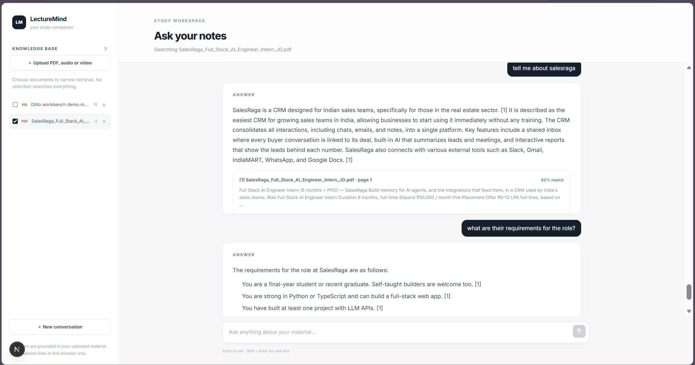
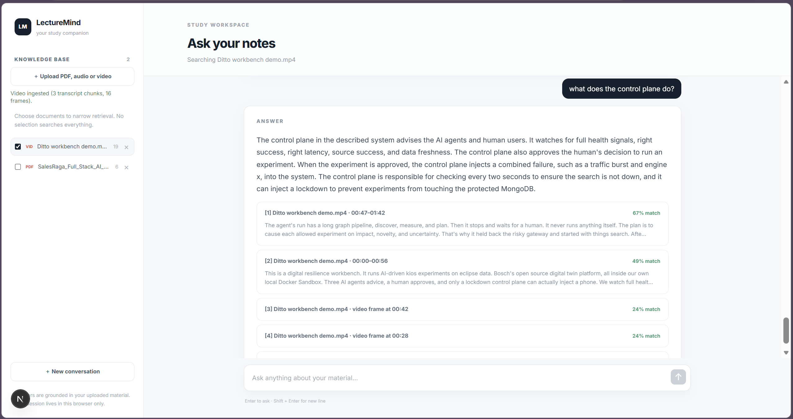

# LectureMindAI

**Chat with your lectures and get answers that cite their sources.** Upload PDFs, audio or video, ask questions in plain language, and every answer points back to where it came from: a page number for PDFs, a timestamp for audio and video, and a frame for video. Retrieval, prompting and session handling run entirely on your own machine: a local LLM (Ollama), local embeddings, a local vector store (ChromaDB) and SQLite. There is no LangChain or LlamaIndex and no paid API.

## Why this project

Lecture material is scattered across slides, recordings and notes, and finding one explanation can mean scrubbing through an hour of video or searching dozens of pages. A general chat model can answer, but it may invent facts that are not in your course. LectureMindAI retrieves the relevant parts of *your* material first, gives only those to a small local model, and refuses to answer when nothing relevant is found.

Design goals:
- Every answer is traceable to a page, a timestamp or a frame
- Refuse rather than guess when the material does not contain the answer
- Run on an ordinary CPU laptop with no GPU and no cloud service
- Measure quality with public benchmarks instead of trusting impressions

## Screenshots

### Chat over a PDF


The sidebar lists the uploaded documents and lets you scope a question to some of them. Answers carry numbered citations such as `[1]`. Each source card shows the file, the page, the retrieved passage and a relevance score.

### Chat over a video


A video is indexed twice: its speech transcript (cited by time range, for example `00:47–01:42`) and sampled frames (cited as `video frame at 00:42`). One question can cite both.

## Core workflow

```text
Upload PDF / audio / video
        ↓
Extract text (PyMuPDF) or transcribe speech (faster-whisper) and sample frames (CLIP)
        ↓
Chunk the content and embed it into ChromaDB
        ↓
Ask a question (follow-ups are rewritten into standalone questions)
        ↓
Retrieve candidates: dense + keyword search, reranked
        ↓
Relevance gate: nothing relevant → "not found", the LLM is not called
        ↓
Local LLM answers from the retrieved passages only
        ↓
Answer with citations (page numbers, timestamps, frames)
```

## Key Features

### Multimodal ingestion
| Input | How it is processed |
|---|---|
| PDF | Text extracted with PyMuPDF, split at section headings, cited by page |
| Audio | Decoded with ffmpeg, transcribed with faster-whisper, chunked by segment, cited by time range |
| Video | Audio transcript **and** frames sampled every 7 s and embedded with CLIP |

### Grounded chat
- Follow-up questions are rewritten using chat history ("what about its cost?" becomes a full question)
- If the best chunk scores below the relevance threshold, the API answers "I could not find that information" without calling the LLM
- Questions with several parts ("stipend for the internship and full-time?") are answered part by part with exact figures
- The source list shows only the passages the answer actually cites, renumbered to match the text, plus any matching video frames
- Cross-modal retrieval: one query can cite transcript text and video frames

### Sessions and documents
- No login: each browser gets a UUID session; documents and chat history are scoped to it and persisted in SQLite
- Document list, select which documents a question searches, and delete (removes vectors and the file)

### Safety and limits
- Per-IP rate limiting, restricted CORS, environment-based configuration
- Upload size, media duration, per-session storage and document-count limits are checked *before* any expensive work
- Heavy ingestion runs one at a time to protect RAM

### Optional quality features (environment variables)
- `USE_HYBRID=1` adds BM25 keyword search to dense retrieval
- `USE_RERANKER=1` reranks candidates with a cross-encoder (a fine-tuned one is trained in `backend/eval/`)
- `USE_GROUNDING_CHECK=1` runs an NLI model that flags answer sentences the retrieved text does not support

## Architecture

```text
Next.js (Tailwind, Axios, react-markdown)
        |  session_id (UUID in localStorage) on every request
        v
FastAPI  --- /upload /query /documents /history /health
   |-- ingestion: PyMuPDF | ffmpeg + faster-whisper | CLIP (frames)
   |-- ChromaDB   text_chunks (MiniLM) | image_frames (CLIP)   <- separate collections
   |-- SQLite     chat history + document ownership
   `-- Ollama     qwen2.5 (/api/generate, stream: false)
```

Details: [docs/architecture.md](docs/architecture.md). Security model and its limits: [docs/security.md](docs/security.md). Code walkthrough with known issues: [docs/PROJECT_WALKTHROUGH.md](docs/PROJECT_WALKTHROUGH.md).

## Technology Stack

| Layer | Technology |
|---|---|
| Frontend | Next.js, React, Tailwind CSS, Axios, react-markdown |
| Backend | Python, FastAPI, Uvicorn, Pydantic Settings, SlowAPI (rate limiting) |
| LLM | Ollama, `qwen2.5:1.5b` by default (`3b` recommended if you have the RAM) |
| Text embeddings | sentence-transformers, `all-MiniLM-L6-v2` |
| Reranker | cross-encoder (`ms-marco-MiniLM-L-6-v2`, or the fine-tuned model in `backend/models/`) |
| Image embeddings | CLIP, `openai/clip-vit-base-patch32` |
| Speech to text | faster-whisper (`base`) with ffmpeg |
| PDF parsing | PyMuPDF |
| Vector store | ChromaDB (two collections) |
| Chat history | SQLite |
| Deployment | Docker Compose (frontend, backend, Ollama) |
| Testing and CI | pytest, GitHub Actions |

### Where each library is used
| Library | Used in | Purpose |
|---|---|---|
| PyMuPDF | `services/pdf_service.py` | extract page text from PDFs |
| ffmpeg, faster-whisper | `services/transcription.py`, `utils/media.py` | decode audio and transcribe it with timestamps; sample video frames |
| CLIP (transformers) | `services/clip_service.py`, `frame_retrieval.py` | embed video frames and match text queries to them |
| sentence-transformers | `services/embedding_service.py`, `retrieval_service.py`, `grounding_service.py` | chunk and query embeddings; reranker and NLI cross-encoders |
| ChromaDB | `db/chroma.py`, `services/retrieval_service.py` | store and search vectors |
| rank-bm25 | `services/retrieval_service.py` | optional keyword search for hybrid retrieval |
| SlowAPI | `limiter.py` | per-IP rate limits |
| Ollama (HTTP) | `services/llm_service.py` | answer generation and query rewriting |

## How retrieval works

**Chunking.** PDF text is split at section headings (short ALL-CAPS lines such as `EDUCATION` or `PROJECTS`). Entries inside a section stay together and each chunk is prefixed with its heading. Documents without headings use overlapping paragraph and sentence chunks (1000 characters, 200 overlap). Audio and video transcripts are chunked by segment so every chunk keeps its start and end timestamps.

**Query pipeline.**
1. Rewrite the question using recent chat history
2. Retrieve candidates: dense search, optionally plus BM25, optionally reranked
3. Compare the best candidate's score to the relevance threshold; abstain if it is lower
4. Send the top chunks to the LLM with an instruction to answer only from them and to cite
5. Keep only the sources the answer cites, renumbered to match the text
6. Optionally check each answer sentence against the context (NLI) and flag unsupported ones

**Ranking with the reranker.** A fine-tuned reranker helps a lot on long documents but can mis-score a short one: on a six-chunk job description it scored the chunk with the answer 0.04 for one phrasing and 0.73 for another. So the final order blends the reranker's ranking with the hybrid (dense + BM25) ranking, weighting the reranker 2x (`RERANK_FUSION_WEIGHT`), and only the best chunk has to pass the relevance threshold. See [docs/evaluation.md](docs/evaluation.md) section 10 for the measurements behind this.

**Thresholds.**

| Setting | Default | Meaning |
|---|---|---|
| Dense relevance threshold | 0.15 cosine | best chunk below this → "not found" |
| Reranker threshold | 0.125 (stock reranker), 0.30 (fine-tuned) | the same gate on the reranker's probability scale |
| Grounding threshold | 0.6 | fraction of supported sentences below which an answer is flagged |

The benchmark-optimal dense threshold is 0.30, but real lecture PDFs often score the right chunk only 0.15-0.3, so 0.15 is the shipped default to avoid false refusals. Set `RELEVANCE_THRESHOLD=0.30` for stricter abstention.

## Current Status

What has been verified, and how:

| Area | Status |
|---|---|
| PDF upload, retrieval, cited answers | Verified end to end with real models (screenshots above) |
| Audio transcription | Verified 2026-10-30 with real speech (Windows text-to-speech WAV, Whisper `tiny` and `base`): correct transcript, cited answer with timestamps |
| Video (transcript + frames) | Verified with a real video: 3 transcript chunks and 16 frames indexed, answer cites both time ranges and frames |
| Backend tests | 53 pass (fake embedder, LLM, Whisper and CLIP, so no model downloads) |
| Frontend | TypeScript check clean; layout fixed to the window with only the chat scrolling |
| Retrieval benchmark | QASPER hit@5 from 0.20 (baseline) to 0.39 with the shipped settings; details below |
| Hallucination detector | Moderate (best F1 about 0.5); treat the flag as a warning, not a guarantee |

Not verified: Docker Compose end to end on a clean machine, and retrieval gains on real lecture material (the benchmarks use scientific papers).

## Prerequisites

- Python 3.11+ (3.14 also works for the backend), Node 20+
- [ffmpeg](https://ffmpeg.org/) on `PATH` (`winget install ffmpeg` / `apt install ffmpeg` / `brew install ffmpeg`)
- [Ollama](https://ollama.com/) with a model pulled (`ollama pull qwen2.5:1.5b`)
- About 4 GB of free RAM for the default setup; more for the larger LLMs or the reranker

## Running the Project

```bash
ollama pull qwen2.5:1.5b

# backend
cd backend
python -m venv .venv && source .venv/bin/activate      # Windows: .venv\Scripts\activate
pip install -r requirements.txt
cp ../.env.example .env                                  # optional: every value has a default
uvicorn app.main:app --port 8000

# frontend (new terminal)
cd frontend
npm ci
npm run dev                                              # http://localhost:3000
```

The first upload or query downloads the embedding model (and Whisper/CLIP when you ingest media), so it is slow once. Open http://localhost:3000.

### Docker
```bash
docker compose up --build
docker compose exec ollama ollama pull qwen2.5:1.5b      # first run only
```
Frontend: http://localhost:3000, API: http://localhost:8000.

### Best-quality profile
For better retrieval and more meaningful match scores, put this in `backend/.env` (the fine-tuned reranker is trained locally with `python -m eval.finetune_reranker`, about 20 minutes on a CPU; the weights are not committed):
```text
USE_HYBRID=1
USE_RERANKER=1
RERANKER_MODEL=models/reranker-lecturemind
RELEVANCE_THRESHOLD=0.30
LLM_MODEL=qwen2.5:3b
```
With the reranker on, the percentage on each source is the reranker's relevance probability.

### Tuning for a CPU-only laptop
The defaults are the lightest configuration: dense retrieval only, no reranker, no NLI check, one ingestion at a time and Whisper `base`.

| Variable | Suggested | Why |
|---|---|---|
| `LLM_MODEL` | `qwen2.5:3b` for better answers, `qwen2.5:1.5b` (default) for speed | the 1.5b model sometimes over-refuses or adds invented detail |
| `USE_HYBRID` | `1` | adds keyword search; helps section words like "projects" |
| `TOP_K` | `4`-`6` | chunks sent to the LLM |
| `LLM_NUM_CTX` | `4096` | smaller context is faster on CPU |
| `OLLAMA_TIMEOUT` | `300` | the first request after a restart loads the model and can be slow |
| `WHISPER_MODEL` | `tiny` | faster transcription, lower quality |

Re-upload documents after changing chunking or the embedding model.

## Demo Workflow

1. **Start the services.** Run Ollama, the backend and the frontend as above.
2. **Upload material.** Use "Upload PDF, audio or video". Audio and video take a few minutes on a CPU because they are transcribed.
3. **Ask a question.** For example "what are the requirements?" or "what does the control plane do?". Tick documents in the sidebar to restrict the search.
4. **Read the citations.** Each source card shows the file, the page or time range, the retrieved text and a relevance score.
5. **Ask a follow-up.** Pronouns such as "it" or "their" are resolved from the chat history.
6. **Ask something unrelated.** The app replies "I could not find that information in the uploaded material" without calling the LLM.
7. **Clean up.** Delete a document with the × in the sidebar, or start over with "New conversation".

## Evaluation and Fine-tuning

An evaluation harness in `backend/eval/` measures retrieval, abstention thresholds, hallucination detection, model size and query rewriting on public benchmarks. Training and evaluation use separate splits, and full methodology, caveats and per-run results are in [docs/evaluation.md](docs/evaluation.md).

| Dataset | Used for |
|---|---|
| QASPER | retrieval evaluation, embedder and reranker fine-tuning |
| SQuAD v2 | abstention threshold, answer generation |
| CoQA | follow-up question rewriting |
| RAGTruth, RAGBench | hallucination detector training and evaluation |

### Retrieval results (QASPER validation, 100 questions)
| Configuration | hit@1 | hit@5 | MRR@10 |
|---|---:|---:|---:|
| MiniLM, fixed chunks (baseline) | 0.06 | 0.20 | 0.12 |
| BGE hybrid + original reranker | 0.13 | 0.34 | 0.22 |
| MiniLM hybrid + fine-tuned reranker (reranker alone decides) | 0.19 | 0.45 | 0.29 |
| **MiniLM hybrid + fine-tuned reranker, blended 2:1 with hybrid rank (shipped)** | 0.13 | 0.39 | 0.24 |

The shipped blend gives up some benchmark score (0.45 to 0.39) in exchange for robustness on short documents. On a six-chunk job description (12 hand-written questions) the chunk containing the answer reached the LLM in 11 of 12 cases, against 8 of 12 with the reranker alone and a per-chunk cutoff. Both tests are small, so treat the numbers as indicative.

### Hallucination detector (fine-tuned NLI model)
| Test set (n=300) | Original AUROC | Fine-tuned AUROC |
|---|---:|---:|
| RAGTruth (held out, never trained on) | 0.65 | 0.74 |
| RAGBench test | 0.61 | 0.60 |

The fine-tune helps on RAGTruth but gives no gain on RAGBench test, so it is not the default.

### Small vs larger LLM (SQuAD v2, n=120)
| | qwen2.5:1.5b | qwen2.5:3b |
|---|---:|---:|
| Answer recall | 0.90 | 0.82 |
| Refuses answerable questions | 5% | 13% |
| Refuses unanswerable questions | 20% | 60% |
| p95 latency | 17 s | 27 s |

### Reproduce
```bash
cd backend
python -m eval.run retrieval     --dataset qasper -n 100
python -m eval.run threshold     --dataset squad_v2 -n 100
python -m eval.run hallucination --source ragtruth
python -m eval.finetune_grounding --pairs 2000 --epochs 2   # hallucination checker, RAGBench train
python -m eval.finetune_embedder  --pairs 3000 --epochs 2   # embedder, QASPER train + hard negatives
python -m eval.finetune_reranker  --pairs 3000 --epochs 2   # reranker, QASPER train
```
Trained weights are written to the git-ignored `backend/models/`. Result files are saved in `backend/eval/results/`.

## API

| Method | Endpoint | Purpose |
|---|---|---|
| POST | `/upload` | upload a PDF, audio or video file (multipart: `file`, `session_id`) |
| POST | `/query` | ask a question (JSON: `query`, `session_id`, optional `selected_documents`, `model`) |
| GET | `/documents` | list the session's documents |
| DELETE | `/documents/{id}` | delete a document (vectors and file) |
| GET | `/history` | load the session's chat history |
| DELETE | `/history` | clear the chat history |
| GET | `/health` | health check |

## Configuration

All settings are environment variables; see [.env.example](.env.example) for the documented list.

| Group | Variables |
|---|---|
| Models | `LLM_MODEL`, `EMBEDDING_MODEL`, `WHISPER_MODEL`, `RERANKER_MODEL`, `NLI_MODEL` |
| Retrieval | `TOP_K`, `RELEVANCE_THRESHOLD`, `USE_HYBRID`, `USE_RERANKER`, `RERANK_FUSION_WEIGHT`, `USE_GROUNDING_CHECK` |
| Limits | 25 MB PDF, 30 min media, 500 MB and 20 documents per session, 1 ingestion at a time |
| Rate limits | `RATE_LIMIT_QUERY` (10/min), `RATE_LIMIT_UPLOAD` (5/min) |
| Server | `OLLAMA_URL`, `OLLAMA_TIMEOUT`, `CORS_ORIGINS`, storage paths |

Do not commit real secrets. `backend/.env` and `backend/models/` are git-ignored.

## Tests

```bash
cd backend
pip install -r requirements-dev.txt
pytest
```
The suite fakes the embedder, LLM, Whisper and CLIP, so it needs no model downloads. It covers chunking, upload limits, every modality's round trip, **session isolation**, deletion (vectors and file), the empty-context guard, citation alignment, rate limiting and error mapping. It never asserts exact LLM wording. GitHub Actions runs the backend tests and the frontend build on every push.

## Project Structure

```text
LectureMindAI/
├── backend/
│   ├── app/
│   │   ├── routes/        # upload, query, documents
│   │   ├── services/      # ingestion, retrieval, llm, grounding, transcription, clip
│   │   ├── db/            # chroma.py, sqlite.py
│   │   ├── utils/         # chunker, media helpers
│   │   └── config.py      # all settings
│   ├── eval/              # evaluation harness and fine-tuning scripts
│   └── tests/
├── frontend/src/          # Next.js app (chat page, upload panel, citations)
├── docs/                  # architecture, security, evaluation, deployment, screenshots
├── docker-compose.yml
├── PROJECT_SPEC.md
└── TASKS.md
```

Where the data goes (all git-ignored and created on the machine that runs the app):

| Folder | Contents |
|---|---|
| `backend/data/uploads/` | uploaded files, one folder per session |
| `backend/data/chroma/` | text and frame vectors |
| `backend/data/chat_history.db` | chat history and document ownership (SQLite) |
| `backend/models/` | fine-tuned model weights |
| `backend/eval/data/`, `backend/eval/results/` | downloaded benchmarks, evaluation run results |

## Troubleshooting

| Problem | Cause and fix |
|---|---|
| `address already in use` on port 8000 or 3000 | The app is already running. Use it, or stop the old process first. Do not start a second copy |
| Frontend styles or scrolling look stale | The Next.js dev cache is stale. Stop `npm run dev`, delete `frontend/.next`, start it again, hard-refresh the page. Never run `npm run build` while the dev server is running |
| "not found" for something that is in the document | Try rephrasing, or raise `TOP_K`. Check the source cards to see which passages were retrieved |
| Transcription failed | `ffmpeg` must be on `PATH`; very long files are limited to 30 minutes |
| Slow first answer | Ollama loads the model on the first request; set `OLLAMA_TIMEOUT=300` |

## Known Limitations

- Retrieval quality is limited (QASPER hit@5 of 0.39 with the shipped settings), and the benchmarks use scientific papers rather than lecture material
- The hallucination flag is only moderately reliable (F1 about 0.5), so treat it as a warning
- The relevance gate separates unrelated questions well on general text but poorly when a question is about an uploaded document that does not answer it
- The `model` field of `/query` is client-controlled; do not expose the API publicly without restricting it
- Sessions are browser-local UUIDs: clearing site data or switching browsers loses access to earlier documents and history. This is a deliberate trade-off, not real authentication
- Scanned PDFs (no text layer) are rejected; there is no OCR
- Local LLMs of this size sometimes miss part of a question or add detail; the larger `qwen2.5:3b` is noticeably better
- URL import was implemented and then removed; media must be uploaded as files

## What I Learned

- Building a RAG pipeline end to end without a framework: chunking, embeddings, retrieval, prompting and sessions
- Why retrieval quality, not the language model, is usually the bottleneck
- Calibrating abstention thresholds with AUROC and sweeps instead of guessing
- Measuring honestly: a fine-tune can win on a benchmark and still fail on a real document, so I tested both and shipped the compromise
- Fine-tuning embedders, rerankers and NLI models on a CPU-only laptop within a few GB of RAM
- Multimodal ingestion (PDF, speech, video frames) and cross-modal retrieval with CLIP
- Working around library breakage (a PyAV/faster-whisper incompatibility) by depending on the stable tool, ffmpeg
- Session isolation, resource limits and rate limiting for an app that accepts uploads
- Testing LLM applications by testing the plumbing around the model, not its exact output

## Future Improvements

- Ship the fine-tuned reranker weights and verify the gain on real lecture material
- Hand-labelled lecture questions for an in-domain metric
- A stronger hallucination detector (more training data, MiniCheck or HHEM)
- Lecture-specific benchmarks (slides plus speech) and long-document PDF benchmarks
- OCR for scanned PDFs
- Real user accounts instead of browser-local sessions
- Larger-n evaluation (n of at least 500) with confidence intervals and 7B/8B model comparisons
- Streaming answers in the chat UI

## Conclusion

LectureMindAI turns a pile of lecture PDFs and recordings into a chat interface whose answers cite their sources. The main engineering focus was keeping each part small and measurable: ingestion, chunking, retrieval, thresholds and hallucination checks are separate pieces with an evaluation behind each, so the system's weak spots (retrieval recall, a moderate hallucination detector) are documented rather than hidden.

## License

No license has been chosen yet (there is no `LICENSE` file in the repository). Add one before sharing the code publicly, and only use the application with material you are allowed to process.
