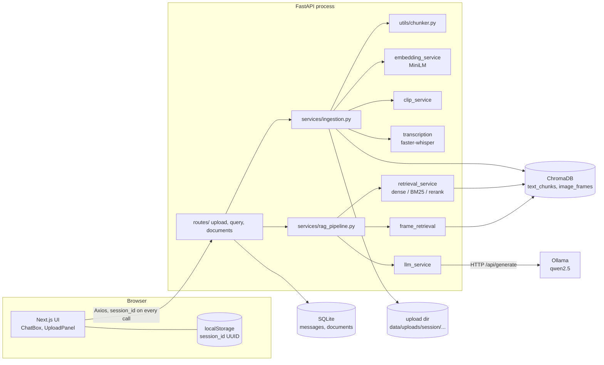
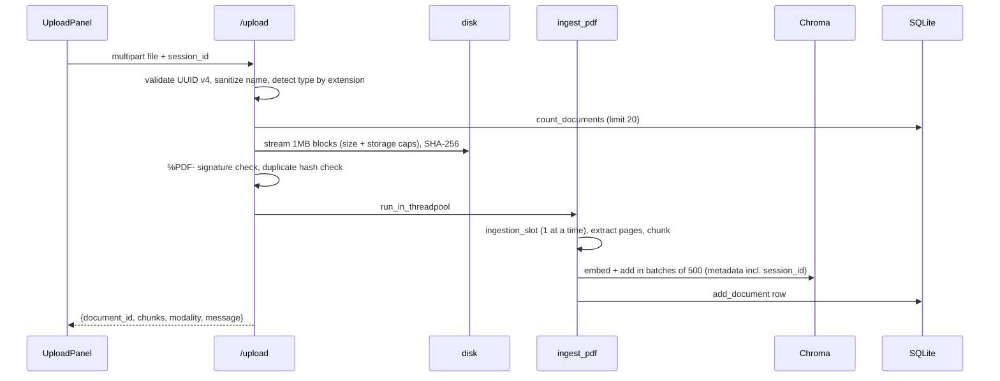

# LectureMindAI — Deep Technical Walkthrough

**Analysed:** branch `claude/sharp-bardeen-o2bpm3`, commit `efcda88` ("fix(chunking): split by section headings…"). `git fetch` showed no newer commits on any remote branch; `origin/main` is at `63339d7` (older, does **not** contain this code).
**Method:** read all application code, config, tests, Docker files and docs; ran small read-only snippets of pure logic (chunker, threshold, rewrite heuristic). I did **not** run the real models (Whisper, CLIP, Ollama), Docker, yt-dlp or ffmpeg.
**Labels:** `[Verified]` in source · `[Measured]` I ran it · `[Documented only]` · `[Partial]` · `[Not found]` · `[Inferred]` · `[Needs my confirmation]`.
Paths are relative to the repo root. No secrets exist in the repo (there are no API keys; Ollama is unauthenticated on localhost) — `.env` is git-ignored (`.gitignore`).

---

# 1. What it does

**Purpose.** A web app where you upload lecture material (PDF, audio, video, or a URL to your own/openly-licensed recording) and ask questions in plain English. It retrieves relevant passages and a **local** LLM (Ollama) answers *only* from them, with citations (page for PDFs, mm:ss for audio/video). [Verified: `backend/app/services/llm_service.py:8` system prompt; `rag_pipeline.py`]

**Users.** A single person at a time per browser. There are no accounts; a random UUID in `localStorage` is the "session". [Verified: `frontend/src/lib/session.ts`]

**Core workflow.** upload → extract text (or transcribe) → chunk → embed → store → ask → retrieve → threshold → LLM → cited answer.

**Technology inventory (used vs. installed vs. documented)**

| Area | Used in code | Notes |
|---|---|---|
| API | FastAPI, Uvicorn, Pydantic, pydantic-settings, slowapi | [Verified] `backend/app/main.py`, `config.py`, `limiter.py` |
| Text embeddings | `sentence-transformers` `all-MiniLM-L6-v2` (default) | `embedding_service.py`; lazily imported |
| Vector DB | ChromaDB `PersistentClient`, 2 collections (`text_chunks`, `image_frames`) | `db/chroma.py` |
| Relational | SQLite (stdlib `sqlite3`) | `db/sqlite.py` |
| LLM | Ollama over HTTP `/api/generate`, `stream:false`, default `qwen2.5:1.5b` | `llm_service.py:45` |
| STT | `faster-whisper` (CPU, int8) | `transcription.py` — **[Partial]** only tested with fakes |
| Video frames | `ffmpeg` → CLIP via `transformers` (`openai/clip-vit-base-patch32`) | `clip_service.py`, `utils/media.py` — **[Partial]** |
| URL import | `yt-dlp` | `url_ingestion.py` — **[Partial]** |
| PDF | PyMuPDF (`fitz`) | `pdf_service.py` |
| Optional (off by default) | `rank-bm25` hybrid search, cross-encoder reranker, NLI grounding check | `USE_HYBRID`, `USE_RERANKER`, `USE_GROUNDING_CHECK` in `config.py` |
| Frontend | Next.js 16.2.6 App Router, React 19, TypeScript, Tailwind 4, Axios, react-markdown | `frontend/package.json` |
| Eval | pandas/pyarrow, HF datasets via parquet URLs | `backend/eval/` — separate from the app |
| Not found | LangChain/LlamaIndex (deliberately absent), FAISS (**despite the resume**), streaming, auth, CI (`.github/` missing), frontend tests | [Not found] |

---

# 2. Architecture and journeys

## 2.1 Style
**Client–server, modular monolith.** One FastAPI process holds routes, pipeline code, model loading and storage access. Independently deployed services: only **Ollama** (a separate process) and the Next.js frontend. Not microservices. [Verified: `docker-compose.yml` has `ollama`, `backend`, `frontend`.]

## 2.2 Component diagram


## 2.3 Layers
entry point `backend/app/main.py` (CORS, error handlers, lifespan creates SQLite schema) → routers `routes/{upload,query,documents}.py` → pipeline `services/` → storage `db/{sqlite,chroma}.py` + filesystem. Cross-cutting: `config.py` (settings), `errors.py` (`AppError`→HTTP status), `limiter.py` (rate limits), `dependencies.py` (`validate_session_id`, `get_retriever`).

## 2.4 Where state lives
| State | Location |
|---|---|
| Session id | browser `localStorage` (`session.ts`) |
| Chat history, document ownership/size/hash | SQLite `chat_history.db` |
| Vectors + chunk text + metadata | ChromaDB dir |
| Original uploads | `data/uploads/<session>/<uuid>_<name>` |
| Loaded models, BM25 index, rate-limit counters, ingestion semaphore | process memory (lost on restart; BM25 rebuilt lazily) |
| Temp media/frames | temp dirs, removed in `finally` |

## 2.5 Journey A — Upload a PDF (`POST /upload`, `routes/upload.py:41`)

Failure paths [Verified]: bad session → 400; unknown extension → 400; too many docs / too large / storage full → 413; not a PDF → 400; no text (scanned) → 422; slot busy >120 s → 503; any exception → partial vectors purged (`purge_vectors`, `ingestion.py:57`) and the file removed (`except BaseException` in the route). UI shows the server's `detail` string (`errorMessage`, `api.ts:51`).

## 2.6 Journey B — Ask a question (`POST /query`, `routes/query.py:29`)
1. Validate session; empty query → 400; if `selected_documents` given, keep only ids owned by the session, none left → 404 (`query.py:36`).
2. `get_history` = last 10 messages from SQLite.
3. `answer_question` (`rag_pipeline.py:38`): **rewrite** (only if history and the query is ≤4 words or has a follow-up pronoun, `llm_service.py:117`) → **retrieve** from `text_chunks` filtered by `session_id` (+ documents) → **threshold** (`select_context`) → optional **frames** from `image_frames` (only if the session has frames) → **LLM** → optional **NLI grounding**.
4. If best score < threshold → "not found" **without an LLM call**.
5. Persist the exchange (`append_turn`), return `{answer, sources, used_documents, context, …}`.
Failure paths: Ollama unreachable → 503; Ollama timeout (`OLLAMA_TIMEOUT`, default 120 s) → 504; rate limit → 429. [Verified: `query.py`]. This is exactly what you saw as "The language model timed out".

## 2.7 Journey C — Audio / video / URL
- **Audio**: ffprobe duration check (limit 30 min) **before** transcription → faster-whisper → `chunk_segments` (keeps start/end timestamps) → embed → Chroma, modality `audio`.
- **Video**: duration check → `ffmpeg` audio track → same transcript path (modality `video_transcript`) + frame sampling every 7 s → CLIP → `image_frames` (modality `video_frame`). `ingestion.py:160`.
- **URL**: `validate_public_url` (http/https only, all resolved IPs must be global) → yt-dlp probe (rejects live streams and over-long media) → download to temp dir → same pipelines → temp dir removed. Document row has `file_path = NULL` and size 0.
[Partial]: all three were only exercised with fakes (`tests/test_api.py::TestAudioVideoUrl`); real Whisper/CLIP/ffmpeg/yt-dlp have never run in this project's tests.

## 2.8 Journey D — Delete (`DELETE /documents/{id}?session_id=`, `routes/documents.py:21`)
Ownership lookup in SQLite by `(session_id, document_id)` → 404 if missing (same 404 for "someone else's" → no existence leak) → delete vectors in **both** collections with `where = {"$and": [document_id, session_id]}` → invalidate BM25 → unlink file only if inside the session's own upload folder → delete the row. Not atomic (see §4).

## 2.9 Data model
```sql
messages(id PK AI, session_id, role CHECK in(user,assistant), content, created_at)  INDEX(session_id)
documents(document_id PK, session_id, filename, modality, file_path NULL, file_size,
          file_hash NULL, chunk_count, uploaded_at)                                   INDEX(session_id)
```
[Verified `db/sqlite.py:15-40`]. **No foreign keys, no `sessions` table, no unique constraint on `(session_id, file_hash)`.** Ownership isolation is by convention: every query adds `WHERE session_id = ?`.
Chroma metadata (text): `session_id, document_id, filename, modality, chunk_id, uploaded_at` + `page` *or* `timestamp_start/end` (omitted, not `None`, because Chroma rejects null — `ingestion.py:_store_text`). Image: `…, modality="video_frame", timestamp`.
If a user guesses another's document id: SQLite lookup includes their own session → 404; Chroma queries/deletes also carry their `session_id`. If they guess another's **session id**, they get everything (it is a bearer token; §4.2).

## 2.10 API inventory
| Method / route | Input | Auth | Notes |
|---|---|---|---|
| `GET /health` | – | none | `{"status":"ok"}` |
| `POST /upload` | multipart `file`, `session_id` | session | 400/413/422/429/503; rate 5/min/IP |
| `POST /upload-url` | JSON `url, session_id, include_frames` | session | 400/413/429; rate 5/min/IP |
| `POST /query` | JSON `query(≤2000), session_id, selected_documents?, model?` | session | 400/404/429/503/504; rate 10/min/IP |
| `GET /documents?session_id=` | query | session | list only own docs, no pagination |
| `DELETE /documents/{id}?session_id=` | | session | 404 for foreign/unknown |
| `GET /history?session_id=`, `DELETE /history?session_id=` | | session | full persisted conversation |
Errors are `{"detail": "..."}`; unexpected errors → generic 500 without a stack trace (`main.py` handlers). No versioning, no pagination. Clients: `frontend/src/lib/api.ts`. Tested: `tests/test_api.py`.

## 2.11 Frontend (`frontend/src/components/ui/ChatBox.tsx`)
On mount it loads documents and the persisted history (`useEffect` at :45), shows a message list, sends `askQuestion` (`:69`), renders answers with react-markdown (no raw HTML) and citation cards (`SourceCard.tsx`: page, or `mm:ss–mm:ss`, or "video frame at mm:ss"). `UploadPanel.tsx` handles file input and URL import with the legal disclaimer. Upload/URL calls have **no client timeout** because CPU transcription can take minutes (`api.ts:73`); queries time out after 180 s.

---

# 3. Core logic in depth

## 3.1 Chunking (`backend/app/utils/chunker.py`)
Goal: pieces that embed well and don't cut ideas in half.
1. `clean_text`: join hyphenated line breaks, collapse whitespace.
2. `_split_sections`: split at **heading lines** = short (≤6 words), ALL-CAPS, ≥4 letters, not ending in `.,;`, not bullets (`_is_heading`, line 65). If the document has no headings it takes the original path (recursive split on `\n\n`, `\n`, `. `, … then greedy packing with overlap).
3. `_units`: inside a section, keep a title/stack/date block together with the bullets that follow, and keep wrapped bullet lines with their bullet.
4. `_pack`: greedy pack up to `chunk_size` (1000 chars) with ~200 chars of overlap, **prefixing every chunk with its heading** so "projects" matches a chunk that begins `PROJECTS`.
[Measured] On your resume text this yields 9 chunks: header, EDUCATION, EXPERIENCE, three `PROJECTS` chunks (one per project), TECHNICAL SKILLS, CERTIFICATIONS, LEADERSHIP — instead of the old 6 chunks that cut mid-bullet and merged sections.
Edge cases: empty → `[]`; chunks shorter than `MIN_CHUNK_CHARS` (40) dropped; non-Latin scripts: `str.isupper()` fails so no headings → falls back safely; a heading that spans pages is only attached on the page where it appears (chunking is per page). Audio: `chunk_segments` never splits a segment; chunk start = first segment start, end = last segment end; overlap = trailing segments up to 200 chars.
Trade-off: bigger chunks = more context but blurrier embeddings and more LLM tokens; overlap protects boundaries but duplicates text.

## 3.2 Retrieval (`services/retrieval_service.py`)
- **Dense** (always): embed query → Chroma cosine search, `n_results=min(CANDIDATE_K=20, count)`, `where = build_where(session_id, document_ids)` (`db/chroma.py:37`). Score = `1 − distance` (cosine similarity because embeddings are L2-normalised).
- **Hybrid** (opt-in `USE_HYBRID`): BM25 over *all* chunks (`_bm25_index`, line 86), then Reciprocal Rank Fusion `Σ 1/(60 + rank + 1)` (`retrieve`, line 139).
- **Rerank** (opt-in): cross-encoder gives a 0–1 probability that replaces the score.
- Output: candidates with `score`.

## 3.3 Abstention — the hallucination gate (`select_context`, line 171)
```python
best = max(c["score"] for c in candidates)
if best < threshold:            return [], "low_relevance"      # no LLM call
floor = max(threshold, best*cutoff) if per_chunk_threshold else best*cutoff
kept = [c for c in candidates[:top_k] if c["score"] >= floor]
```
Threshold default: `0.125` with reranker (probability, calibrated on SQuAD v2), else `0.15` cosine for MiniLM (a **judgement call, not calibrated** — `config.py`, `DENSE_RELEVANCE_THRESHOLD`). `per_chunk_threshold` is `False` in dense mode: raw cosine for the *right* chunk is often only 0.15–0.3, so using the absolute threshold per chunk threw away the answer (this was your "projects" bug).
**Known flaw [Measured]:** with `USE_HYBRID=1` and no reranker, a keyword-only (BM25) hit gets the neutral score `0.15` (`retrieval_service.py:165`), which **equals** the threshold, so `select_context` does *not* abstain — I ran it: `select_context([{"score":0.15}], threshold=0.15)` → no abstain. So the "no LLM call" guard is weakened and the LLM's own refusal has to do the work.

## 3.4 Generation (`llm_service.py`)
Prompt: use ONLY numbered passages; cite `[n]`; answer from any related passage; only if none relate, output the exact not-found sentence; list every item for list questions. `generate_answer` formats `[n] (filename, page N | mm:ss–mm:ss)` + text, plus a separate "visually related video frames" list. Refusal detection is a **substring match** (`is_not_found`, line 112). `temperature=0`, `num_ctx=8192` by default (you used 4096), timeout from settings.

## 3.5 Cross-modal merge (`frame_retrieval.py`, `rag_pipeline.py`)
CLIP text→image cosine (~0.2–0.35) and MiniLM cosine (~0.3–0.8) are not comparable, so each collection is queried and thresholded on its own scale (`IMAGE_MIN_SCORE=0.2`) and frames are shown in a separate labelled section. CLIP is only loaded if the session has frames (`collection.get(where=…, limit=1)`). If only frames match, the answer is a deterministic list of timestamps with **no LLM call**.

## 3.6 Query rewrite (`llm_service.py:117-150`)
Only when there's history **and** (query ≤4 words or follow-up pronoun regex). [Measured] `"her projects?"` → rewrite=True; `"What are the certifications listed on the resume?"` → False. Failure falls back to the original query. Cost: one extra LLM call for short queries.

## 3.7 Idempotency & reversibility
Upload is idempotent per session by SHA-256 (returns `duplicate:true`); but there is no DB uniqueness, so concurrent identical uploads can race. Delete is destructive and not reversible. Failed ingestion purges vectors by `document_id`.

## 3.8 Evaluation harness (offline, not part of the app) — `backend/eval/`
`python -m eval.run retrieval|threshold|generation|hallucination|conversation` on QASPER, SQuAD v2, CoQA, RAGTruth (+ RAGBench loader, **unverified columns**). **[Measured by a previous run, committed JSON in `backend/eval/results/`, 2026-10-19]**: QASPER (112 q) hit@5: baseline 0.20 → dense BGE 0.26 → hybrid 0.28 → hybrid+rerank 0.37; hit@1 0.06 → 0.14. Abstention (SQuAD v2, 30+30 q) AUROC 0.994 for out-of-corpus questions at reranker threshold 0.125. NLI hallucination check on RAGTruth: AUROC 0.65 (mean groundedness) / 0.74 (min-support), at the old threshold precision 0.21, recall 0.92. LLMs on SQuAD v2 (n=120): 1.5b false-refusal 5%, refuses 20% of unanswerable; 3b 13% and 60%; p95 17 s vs 27 s. **These do not describe the current default config** (MiniLM, dense) — they were measured with BGE+hybrid+rerank. A fine-tuned NLI grounding checker has since been trained and evaluated (see `docs/evaluation.md` section 8); `backend/models/` is git-ignored.

---

# 4. Bugs, limits and risks

## 4.1 Confirmed issues (prioritised)
| # | Issue | Evidence | Impact | Fix / trade-off |
|---|---|---|---|---|
| 1 | Client can pick any Ollama model | `models.py` `QueryRequest.model`; [Measured] accepted `"llama3:70b"` | Resource abuse / OOM on a shared host | allow-list models server-side |
| 2 | Abstain guard bypassed in hybrid mode | §3.3 [Measured] | Irrelevant questions reach the LLM; relies on string-matched refusal | give BM25-only hits score 0 and gate on dense-best, or calibrate |
| 3 | Refusal detection by substring | `llm_service.py:112` | Paraphrased refusals shown as answers | return a structured flag/JSON or validate with a score |
| 4 | Session id is a bearer token in the URL query string | `routes/documents.py`, `routes/query.py` (`GET /history`) | Appears in access logs / proxies; anyone with the UUID has full access | move to an `X-Session-ID` header; real auth later (`docs/security.md`) |
| 5 | Delete/ingest touch 3 stores non-atomically | `documents.py:21-40`, `ingestion.py:118+` | Crash mid-way leaves orphan vectors/rows/files | order ops + a reconciler job, or one transactional store |
| 6 | No `UNIQUE(session_id, file_hash)` | `db/sqlite.py` | Double-click uploads can create duplicates | add the constraint, catch the conflict |
| 7 | BM25 index covers all sessions and is rebuilt from the whole collection on every upload/delete | `retrieval_service.py:86` | O(corpus) RAM/time, cross-session data held in one structure (filtered only at result time `_sparse`) | per-session index, or Chroma/SQLite FTS |
| 8 | SSRF check is check-then-use | `url_ingestion.py:22-34` | DNS rebinding / redirects can bypass it | resolve once and pin the IP, block redirects to private ranges |
| 9 | Whisper timeout is cooperative | `transcription.py:17` | Model load / first-segment latency not bounded; a long job makes other uploads wait then 503 after 120 s | run in a subprocess/queue with a hard kill |
| 10 | Rate limiter is in-process and IP-keyed | `limiter.py` | Multiple workers multiply the limit; behind a proxy everyone shares one bucket | Redis-backed limiter + `X-Forwarded-For` handling |
| 11 | `top_score` is taken from `candidates[0]` | `rag_pipeline.py:74` | In hybrid mode candidates are RRF-ordered, so it may not be the max | use `best` |
| 12 | `.env` read relative to the working directory | `config.py` `env_file=".env"` | Starting uvicorn from the repo root silently ignores `backend/.env` | absolute path from `BACKEND_DIR` |
| 13 | Fine-tune script default base is now MiniLM | `eval/finetune_embedder.py` (`--base` default `config.EMBEDDING_MODEL`) vs docs saying BGE | Docs and defaults disagree | pass `--base BAAI/bge-small-en-v1.5` |
| 14 | History restored without sources; no pagination on `/documents`; errors use `alert()` | `ChatBox.tsx` | UX gaps | persist sources, paginate |
| 15 | PDF headings split per page | `chunker.py` | Section that spans pages loses its prefix on later pages | carry the last heading across pages |

## 4.2 Security posture (separating confirmed from potential)
**Confirmed controls:** per-session scoping in SQLite and Chroma on every read/write; UUID v4 validation (400); extension allow-list + `%PDF-` signature + ffprobe validity; filename sanitisation and storage under `<session>/<uuid>_<name>`; delete confined to the session folder (`documents.py:35-37`); size/duration/storage/doc-count caps checked before heavy work; streamed uploads; rate limits; CORS restricted by env; markdown rendered without raw HTML; no stack traces to clients. **Potential risks:** items 1, 4, 8, 10 above; files stored unencrypted; no HTTPS in the compose file; no auth. `session_id` is NOT a security boundary (stated in `docs/security.md`).

## 4.3 Performance / scalability
- Query cost is dominated by LLM generation on CPU (seconds to tens of seconds; eval p50 7 s / p95 17 s for 1.5b) **[Measured by prior run]**; embedding/Chroma search is milliseconds–tens of ms (retrieval ~28–43 ms dense/hybrid, ~1.1 s with reranker **[Measured by prior run]**).
- Ingestion is synchronous inside the HTTP request (long for audio/video) and serialised by a semaphore (`MAX_CONCURRENT_INGESTIONS=1`) to protect RAM — chosen because your Windows machine froze under load.
- Blocking `requests` to Ollama runs in the default threadpool; many slow queries hold threads for up to `OLLAMA_TIMEOUT`.
- **At 10×:** background job queue with status polling for ingestion; per-session/BM25 index; Redis rate limiter; Chroma server mode; hosted GPU LLM. **At 100×:** Postgres + pgvector (or managed vector DB), object storage for files, real auth, horizontally scaled stateless API, observability (metrics/tracing).

## 4.4 Tests
44 tests, all green here **[Measured]** (`pytest`): `tests/test_api.py` (health, CORS, upload limits, duplicate, PDF round trip & metadata schema, audio/video/URL with fakes, **session isolation**, deletion removes vectors+file+row, empty-context guard, LLM 503/504, rate limit 429, history persistence), `tests/test_chunking_and_utils.py` (chunking incl. your resume as `tests/resume_sample.txt`, session id, filenames), `tests/test_rag_primitives.py`. They fake the embedder (`conftest.FakeEncoder`), LLM, Whisper, CLIP and ffmpeg steps, so they prove the **plumbing**, not answer quality, and not real media decoding. **[Not found]:** frontend tests, CI, load tests, tests for `eval/`. Safe to run (temp dirs, no network).
**Suggested next tests:** one real-model smoke test (tiny PDF + 5-s audio) marked `slow`; Playwright upload→ask→delete; concurrency test for duplicate upload; property test for the chunker (concatenation covers the input).

## 4.5 Operations
Run: `uvicorn app.main:app --port 8000` (backend), `npm run dev` (frontend), Ollama running with the model pulled. Config via env/`.env` (`.env.example`). **[Verified]** `npm run lint` and `npm run build` pass. **[Documented only / untested]** `docker compose up` (Ollama service + backend + frontend) and the production frontend image (`output: "standalone"` in `next.config.ts`). Common failures: port 8000 already used by an old server; `slowapi`/`pydantic-settings` not installed in the venv; Ollama not running (503) or cold-loading (504); Python 3.14 may lack wheels for `faster-whisper`/torch; running uvicorn from a different folder (item 12).

## 4.6 What I'd do with another week
1. **Reliability of retrieval:** fix the hybrid abstain bug, add a real calibrated threshold per embedder, fine-tune/choose BGE, contextual headers, then re-run the eval harness on the shipped config.
2. **Auth/safety:** header-based session, model allow-list, per-session query quotas, SSRF-safe downloader.
3. **Durability:** ingestion as a background job (status endpoint), a reconciler for orphans, unique constraint.
4. **Real integration tests + CI** (GitHub Actions: pytest, lint, build) and a nightly real-model smoke test.

---

# 5. Interview / learning material

## A. Explanations
**2 minutes.** "LectureMind lets you upload lecture PDFs, audio or video and ask questions with cited answers. I split documents into section-aware chunks, embed them with MiniLM and store them in ChromaDB; audio/video go through Whisper and video frames through CLIP into a separate collection. At query time I retrieve the top chunks for that session, and if even the best one is below a relevance threshold the system says 'not found' without calling the LLM. Otherwise a local Ollama model answers only from the retrieved text and cites page numbers or timestamps. Each browser has its own session, so documents and chat history are isolated. I evaluated retrieval and hallucination control on public datasets; retrieval was the weak spot (37% hit@5 on research papers) and chunking by section was a big practical fix on resumes."

**5 minutes.** Add: the ingestion flow and limits (stream to disk, caps before work, one ingestion at a time for RAM), the dual vector collections and why scores aren't merged, SQLite for history/ownership, rate limiting, error mapping (429/503/504), the optional quality features (hybrid, reranker, NLI) and what the eval showed, and honest limits (single process, sync ingestion, session = bearer token, media paths only tested with fakes).

## B. Five code walkthroughs
**1. Streaming upload with limits** (`routes/upload.py:22`)
```python
digest, size = hashlib.sha256(), 0
used = sqlite.total_storage(session_id)
with open(dest, "wb") as out:
    while block := await file.read(BLOCK):          # 1 MB at a time
        size += len(block)
        if size > max_bytes: raise AppError(413, ...)
        if used + size > settings.max_storage_per_session_bytes: raise AppError(413, ...)
        digest.update(block); out.write(block)
```
Why: reading `await file.read()` whole would put a huge video in RAM (that is what froze your PC earlier). Limits are enforced *as bytes arrive*; the hash is computed in the same pass for dedupe. The caller's `except BaseException` deletes the partial file.

**2. Session scoping** (`db/chroma.py:37`, `routes/documents.py:21`)
```python
clauses=[{"session_id": session_id}]; if document_ids: clauses.append({"document_id":{"$in":...}})
return clauses[0] if len(clauses)==1 else {"$and": clauses}
```
Every Chroma query/delete goes through this or an equivalent `$and`; SQLite uses `WHERE session_id = ?`. Deleting uses ownership lookup first, so a foreign id gives the same 404 as an unknown one.

**3. The abstention gate** (`retrieval_service.py:171`) — see §3.3. Explain the two thresholds and the `per_chunk_threshold` fix.

**4. Section-aware chunking** (`utils/chunker.py:116`) — see §3.1; show `_is_heading`, `_units`, and the heading prefix.

**5. The pipeline** (`rag_pipeline.py:38`): rewrite → retrieve → `select_context` → frames → (abstain) → generate → `is_not_found` → optional grounding. Walk through what each early return means and what the UI shows.

## C. ~40 questions with answers
**System design**
1. *Why RAG instead of fine-tuning?* Knowledge changes per user; RAG gives citations and no retraining. Fine-tuning would only improve the embedder/reranker, not inject facts.
2. *Why two Chroma collections?* Text (384-d MiniLM) and CLIP (512-d) live in different spaces; mixing breaks distances. Scores also aren't comparable, so I threshold each separately and show frames in their own section.
3. *Why a threshold before the LLM?* Cheap, deterministic guard: no relevant context → no generation → can't hallucinate and saves seconds of CPU.
4. *Why chunk with overlap?* Ideas straddle boundaries; overlap preserves them at the cost of duplicate storage.
5. *Why section-aware chunking?* Fixed windows cut bullets and merged sections; a heading prefix makes "projects" match.
6. *Why dense-only by default?* Project spec says no hybrid/reranker in V1; also lowest RAM. I kept them as flags because the eval showed gains.
7. *How would you scale ingestion?* Job queue (Celery/RQ), worker pool, status endpoint, object storage.
8. *Why SQLite?* Zero-ops, enough for single-process V1; Postgres when multi-instance.
9. *Why Ollama?* Free, local, simple HTTP API; trade-off: CPU latency.
10. *How do follow-ups work?* Rewrite step turns "how is it trained?" into a standalone query using the last 10 messages.

**API / data**
11. *Why 413 vs 400?* 413 = payload too large (size/duration/quota), 400 = malformed input.
12. *Why return the same 404 for foreign documents?* Avoid leaking existence.
13. *Why UUID v4?* Unguessable, generated client-side; but it's a bearer token, not auth.
14. *Idempotent upload?* SHA-256 per session; weakness: no unique constraint.
15. *Why no foreign keys?* Sessions are implicit; I'd add a `sessions` table + FKs with real users.
16. *Pagination?* Missing; fine at ≤20 docs/session.
17. *Why omit `None` from Chroma metadata?* Chroma rejects null values.

**Concurrency / consistency**
18. *What if two uploads run at once?* A semaphore serialises ingestion; the hash check can race → unique constraint needed.
19. *Crash during delete?* Vectors could be gone while the row remains; fix with ordering + reconciler.
20. *Is the BM25 index thread-safe?* Guarded by a lock; invalidated on upload/delete; rebuilt lazily.
21. *Why `run_in_threadpool`?* Embedding/LLM/IO are blocking; keeps the event loop free.

**Auth / security**
22. *Biggest security gap?* Session id as bearer token in URLs, client-chosen LLM model, SSRF check-then-use.
23. *How do you prevent path traversal?* `safe_filename`, uuid-prefixed names, delete only inside the session folder.
24. *Why validate the PDF signature?* Extension/MIME can be spoofed.
25. *CORS?* Origins from env; credentials disabled with `*`.
26. *XSS?* react-markdown doesn't render raw HTML.
27. *What if someone uploads a 20 GB file?* Streamed with a cap → 413, partial file removed.

**ML / retrieval**
28. *Why cosine?* Embeddings are normalised; `1 − distance`.
29. *What's RRF?* Combine rankings: `Σ 1/(60+rank)`; robust to different score scales.
30. *Why rerank?* Cross-encoder reads query+chunk together; doubled hit@1 in my eval but costs ~1 s.
31. *How did you pick the threshold?* Swept on SQuAD v2 (answerable vs unanswerable); 0.125 for the reranker. The dense 0.15 is **not** calibrated — I'd run the harness.
32. *How do you control hallucination?* Three layers: threshold gate, restrictive prompt + `temperature=0`, optional NLI check (weak: AUROC 0.65–0.74, so a warning).
33. *Why is exact match ~0?* LLM answers are sentences; use answer-recall/F1.
34. *1.5b vs 3b?* 3b refused unanswerable questions more reliably but also refused more answerable ones and was slower.

**Testing / debugging scenarios**
35. *"Answers say 'not found' in prod" — investigate?* Check `abstain_reason` and `top_score`/`sources` in the response, look at chunks, threshold, whether the doc ingested (chunk count), whether hybrid neutral scores or prompt refusals are involved.
36. *"Query times out"* Ollama cold start/num_ctx; check `ollama ps`, timeouts, TOP_K, model size.
37. *"Upload hangs"* Semaphore busy, Whisper running; check logs, duration; ffmpeg missing → 500 message.
38. *"Another user sees my docs"* Check the `where` filters and session id handling; test in `TestSessionIsolation`.
39. *What do your tests not cover?* Real models, frontend, CI, concurrency.
40. *How do you test LLM code?* Fake the LLM, assert on prompt/context assembly and error mapping — never exact wording.

## D. Defend / critique (8 hard challenges)
1. **"Your resume says streaming and FAISS."** — "Wording was imprecise: it's ChromaDB and `stream:false`. I'd fix the resume." (Honest.)
2. **"Retrieval is only 37% hit@5."** — Measured on hard QASPER papers with strict n-gram relevance; I know the levers (candidate pool, reranker, fine-tune, chunk headers) and fixed a concrete chunking issue on resumes.
3. **"Session id isn't security."** — Agreed; documented; it's isolation for a no-login demo; plan: header + real auth.
4. **"Hybrid mode bypasses your guard."** — Yes, found and measured; fix is to gate on dense-best.
5. **"Ingestion blocks the request."** — Accepted V1 simplification; job queue next.
6. **"Why not LangChain?"** — Deliberate: understand every step; trade-off is more code.
7. **"Why trust a 1.5b model?"** — I don't; retrieval + threshold + prompt reduce risk; 3b for demos; measured refusal/false-refusal.
8. **"Is it tested on real media?"** — Honest: plumbing tested with fakes; real Whisper/CLIP/yt-dlp not yet exercised.

## E. Project story (fill in personal parts)
*Problem:* students can't search lecture material in natural language with trustworthy citations. *Design:* §2. *My contribution:* [YOU FILL: what you designed/wrote vs. generated with AI]. *A real challenge:* retrieval returned "not found" for "her projects" — root cause was chunking merging sections and a per-chunk threshold dropping the right chunk; fixed with section-aware chunking and a gate on the best chunk. *Key decision:* separate collections + per-collection thresholds. *Lessons:* evaluate on real data early; make guards measurable; keep optional features behind flags.

## F. Honesty audit
- Proven by code/tests: PDF path, session scoping, limits, citations, abstention gate, SQLite history, 44 passing tests, frontend builds. You ran the PDF flow on your machine (your pasted outputs).
- Uncertain: real audio/video/URL ingestion, CLIP quality, Docker, deployment, the fine-tuned embedder (not trained), performance numbers for the current default config.
- Safe wording: "implemented audio/video/URL ingestion with Whisper and CLIP; I've mainly demoed and measured the PDF path." "Evaluated retrieval and hallucination control on QASPER, SQuAD v2, CoQA and RAGTruth." Avoid: streaming, FAISS, "trained/fine-tuned a model", "deployed", user-test numbers you can't back.

## G. Personal facts only you can confirm
Who wrote which parts; whether the "~12 users incl. faculty" test happened and what was measured; whether you actually used FAISS anywhere; your hardware (RAM) and which model you demo with; whether Docker was ever run; the date/timeline of the project; mentor feedback.

## H. One-page revision sheet
- **Flow:** upload → stream to disk (caps) → extract → section-aware chunk → MiniLM embed → Chroma (`session_id` in metadata) + SQLite row → ask → (rewrite) → dense retrieve (session-filtered) → gate on best score → top-k → LLM `/api/generate` (T=0) → cited answer → save to SQLite.
- **Numbers:** chunk 1000/200, top-k 4 (you ran 4–6), threshold 0.15 cosine / 0.125 reranker, limits 25 MB PDF, 30 min media, 500 MB & 20 docs per session, 10 q/min & 5 uploads/min per IP, history 10 msgs.
- **Eval:** QASPER hit@5 0.20→0.37, hit@1 0.06→0.14; abstention AUROC 0.994 (out-of-corpus); NLI AUROC 0.65–0.74; 1.5b vs 3b: 5%/20% vs 13%/60% (false-refusal / refusal on unanswerable).
- **Weaknesses to volunteer:** bearer-token session, hybrid guard bug, sync ingestion, non-atomic delete, media untested on real models, no CI/frontend tests.
- **Files to know:** `rag_pipeline.py`, `retrieval_service.py`, `chunker.py`, `routes/upload.py`, `ingestion.py`, `db/sqlite.py`, `ChatBox.tsx`.

---

# 6. Personal facts needed
See §5-G.

# 7. Claims you must not make without evidence
- "Streaming responses" — the app uses `stream:false` everywhere.
- "FAISS" — not used.
- "Fine-tuned / trained our own model" — the script exists, no trained model or result in the repo.
- "Deployed / live" — no deployment exists; Docker is untested.
- "Works for audio/video/URL end to end" — only tested with fakes.
- "Tested with ~12 users" — unverifiable from the repo.
- "Hallucination-free" / any accuracy number for the **current default** configuration — the committed eval numbers are for BGE+hybrid+rerank, and the dense 0.15 threshold is uncalibrated.

> **Update:** URL ingestion (`yt-dlp`, `POST /upload-url`, `url_ingestion.py`, the SSRF guard) has since been removed from the project. Any mention of URL import above is obsolete.
